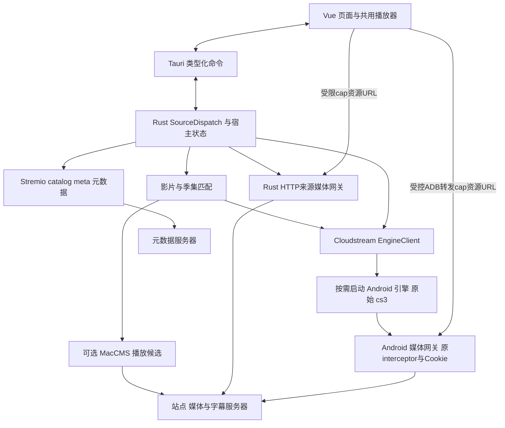
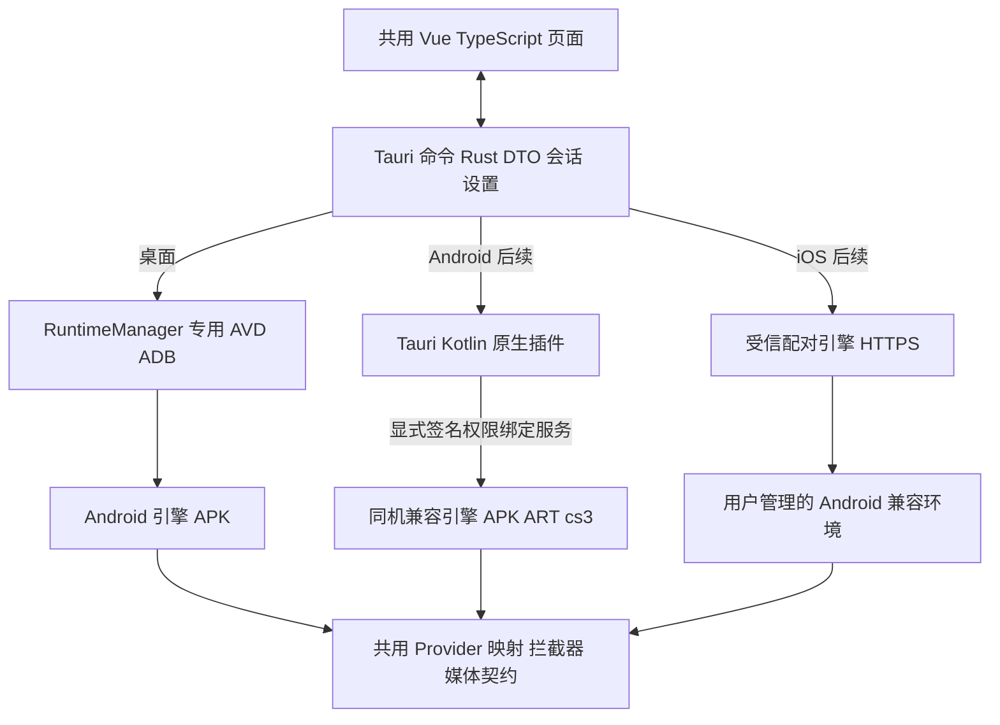

# Tauri Rust 跨平台视频客户端开发规格

版本 1.5.0。日期 2026-10-26。读者：负责开发、审查和验收的 AI 及维护者。

本项目以推荐、详情、选集和播放构成最小产品闭环。客户端采用 Tauri 2 + Rust，界面默认采用 Vue 3 + TypeScript + Vite；Stremio HTTP扩展提供推荐、详情与元数据集数，Cloudstream提供主播放源，MacCMS作为可选播放源。Rust执行元数据HTTP、跨源匹配与MacCMS适配，给定索引中的原始 `.cs3` 在按需启用的Android兼容引擎执行。macOS、Windows、Linux 在同一首版发布中达到本规格的交付条件。后续移动端纳入架构规划，Android 优先验证，iOS 单独验证插件执行路径。

## 1 需求与决策

### 1.1 用户确定的要求

| ID | 要求 | 交付含义 |
|---|---|---|
| U01 | 使用 Tauri + Rust | WebView 承载页面，Rust 管理命令、引擎客户端、桌面运行环境与持久化 |
| U02 | 使用给定 Cloudstream 索引 | provider提供播放候选搜索、详情与媒体解析；原首页能力用于兼容测试 |
| U03 | 推荐、详情、播放等基本功能 | 实现完整真实数据与媒体闭环 |
| U04 | 三平台同期支持 | macOS、Windows、Linux 都有可安装、可运行的首版 |
| U05 | 直接兼容全部原始 `.cs3` | 基线7包保持字节一致，由真实兼容运行时加载和调用 |
| U06 | AI 可直接开发 | 数据契约、模块职责、依赖顺序、错误行为和验收可执行 |
| U07 | 后续支持移动端 | 首版保留可复用界面和 Rust 业务边界；Android/iOS 按第16章分阶段实施 |
| U08 | Stremio元数据与Cloudstream播放分工 | 推荐/详情使用Stremio；Cloudstream主播放，MacCMS可选播放；跨源匹配后进入共用播放器 |
| U09 | 观看历史与SQLite | 历史页面、进度与续播；SQLite本轮确定技术约定，T18接入宿主后验收持久化 |

### 1.2 本规格采用的实施默认值

这些是为实施补足的产品决策，可在开发前统一修订；开发中按本表执行。

| 项目 | 默认值 |
|---|---|
| 首页推荐 | 所选Stremio元数据配置的catalog栏目，保持扩展顺序 |
| 源选择 | 元数据配置与播放源分别选择；播放源默认Cloudstream，MacCMS用户显式启用 |
| 默认源 | 元数据优先恢复last_metadata_config_id，否则选首个ready且home/details可用的Stremio配置；播放源独立恢复last_playback_source_key，缺省提示准备Cloudstream，用户可选择MacCMS |
| HTTP配置 | 用户添加MacCMS API URL或Stremio manifest URL列表；P0使用匿名公开接口，见第18章 |
| 接入顺序 | 先完成Stremio元数据与受控MacCMS播放样本的匹配闭环，再接Cloudstream主播放；MacCMS保留可选状态 |
| 前端默认值 | Vue 3 + TypeScript + Vite；单页应用，本地打包静态资源 |
| 播放方式 | WebView 内嵌 HTML video；HLS 按能力选原生播放或 hls.js |
| 移动端节奏 | 桌面首版 → Android 真机闭环 → iOS 引擎方案与真机验证 |
| 核心媒体 | HTTP MP4、HLS，包括主清单、分片、AES-128 Key、初始化片段 |
| 其他清晰媒体 | 若基线插件输出清晰 DASH，则纳入同一媒体验证门与代理测试 |
| 系统目标 | macOS 14+ arm64/x86_64；Windows 11 x86_64；Ubuntu 24.04 x86_64 |
| Linux 显示 | X11 与 Wayland 均验证 |
| 本地数据 | SQLite观看历史与进度、设置JSON、原始索引缓存、插件版本锁、Android源站会话数据 |
| 后续候选 | 搜索界面、收藏、本地媒体库、更多 CPU 架构 |

首版页面包括首页、详情、播放器、观看历史、源选择与必要的引擎初始化/设置。桥接层保留 Cloudstream search 方法用于插件兼容测试；搜索界面属于后续候选。

### 1.3 范围约束

产品采用新代码、新标识和新资源表达基础视频体验。参考软件分析产物只用于理解功能关系。首版采用三类来源数据与标准媒体播放；范围按 U01 至 U09 执行；U07 首版交付为可复用结构与移动端实施计划，移动端发布安排在后续阶段。

P2P 下载共享、静默后台上传、账户体系、VIP、支付、广告、评论、离线下载、自动开机启动及自建影片后端均属于本期范围之外的功能。

## 2 Cloudstream基线与HTTP接入依据

### 2.1 索引与原包基线

索引地址：

```text
https://raw.githubusercontent.com/821938089/cloudstream-extensions/builds/plugins.json
```

固定提交：`d411c9597e16f1e12f51f563ef75cd8d00ace002`。

索引 SHA-256：`a514c083b372a2016a2a87ba0425d559caa8432372176ec78cdce346350643ef`。

| 插件 internalName | 版本 | 语言 | 原包字节数 |
|---|---:|---|---:|
| DdysProvider | 2 | zh | 17375 |
| DramacoolProvider | 4 | en | 13344 |
| LibvioProvider | 8 | zh | 18090 |
| MxplayerProvider | 3 | hi | 31617 |
| SuperVod | 12 | zh | 52115 |
| YjysProvider | 1 | zh | 23376 |
| ZxzjProvider | 1 | zh | 20411 |

全部原包均为 ZIP，含 `manifest.json` 和 `classes.dex`。每包实际 `pluginClassName`、SHA-256、固定提交下载地址见 `references/plugin-artifact-inventory.json`。

索引读取必须支持 `iconUrl`、`authors` 等可选字段缺失及未知扩展字段。插件主键使用 `internalName`，版本使用数值；显示名与主键分开保存。`fileSize` 用于长度检查，制品 SHA-256 用于基线身份检查。当前索引缺少发布方签名/摘要字段时，本机计算摘要记录的是下载制品身份。

### 2.2 Android 运行环境

Cloudstream 上游加载器使用 Android `PathClassLoader` 加载插件，并调用插件注册 provider。工程将保留这一真实运行路径。[S03]

采用固定 Cloudstream Android 分支，在原 app 模块增加引擎入口、桥接服务和媒体网关，复用其 Application 初始化、插件加载器、APIHolder、共享网络客户端、Cookie、extractor 与 WebView 相关能力。先保留成熟运行时，再按证据移除无关启动入口，避免重建一套 API stub。

引擎入口启动必要的前台Activity与桥接生命周期，保持原插件依赖的Android上下文。上游自动更新、默认仓库批量安装、账号启动流程和外发诊断按引擎模式关闭；7包安装与请求只经本项目明确入口触发。Android客体负责取数和代理，音视频解码在桌面运行。

首个候选上游提交为 `a7ac454af8fbd64574c96847a936905855911720`。该提交是研究时的固定候选，7 包实际加载测试通过后才写入生产 `runtime.lock.json`。若发生二进制符号错误，应选择匹配的历史 API 或补齐运行时兼容 ABI；原始 `.cs3` 字节保持基线一致。

### 2.3 一包可注册多个 provider

`SuperVod` 的 `load(context)` 会注册多个 provider。[S05] 引擎必须枚举实际注册实例，记录包到实例的完整映射。

| 概念 | 身份 |
|---|---|
| 插件包 | internalName + artifact SHA-256 |
| provider 实例 | internalName + 固定 registration_key；制品更新另用 source_revision |
| 内容 | provider ID + 原始 opaque data |
| 集数 | provider ID + 原始 episode data |

同名 provider 仍保留独立实例。展示名、语言、站点域名均作为属性。版本更新产生的新实例映射必须可追溯到新制品；缓存与媒体会话带 `source_revision` 防止跨版本误用。

### 2.4 opaque data 与视频拦截器

Cloudstream 的内容引用和 episode data 可能是 URL，也可能是序列化 JSON。例如 SuperVod 基类把 Vod/PlayData 作为字符串传递。[S06] 桌面端按不透明字符串透传，保留内容、编码和字段语义。

部分 provider 实现 `getVideoInterceptor(link)`。已读源中包含去除 Referer，以及处理特殊响应后重新生成 m3u8 的逻辑。[S07] 因此媒体请求由 Android 网关执行原运行时网络行为，随后交给桌面播放器解码。

### 2.5 新增HTTP来源

MacCMS提供HTTP JSON采集接口；Stremio通过manifest声明catalog/meta/stream/subtitles能力。[S26][S27] 本项目的具体支持范围、配置、映射与测试要求见第18章。当前只核对协议/上游实现；具体站点及扩展的在线闭环在开发阶段验证。

## 3 最小可行系统架构




前端控制请求通过 Tauri invoke 进入 Rust。[S12] Rust维护宿主世代、来源配置与资源句柄，按需持有Cloudstream控制令牌；前端持有页面 DTO 和必要的媒体资源访问凭据。视频字节直接经过资源网关流向 WebView，避开逐帧 IPC 与整片内存缓冲。移动端沿用页面、DTO 和命令语义，平台执行路径见第16章。


### 3.1 必要组成与成本

| 组成 | 必要性 | 控制复杂度的方法 |
|---|---|---|
| Tauri 应用与 Vue 页面 | 用户指定技术、桌面界面与后续移动复用 | 一个前端项目、一个 Rust app crate |
| Android 引擎 APK | 执行原始 DEX 与 Android 插件 API | 复用固定上游运行时，补桥接层 |
| 专用 AVD | 启用Cloudstream时本机运行Android ART | 单个由本项目管理的虚拟设备 |
| ADB 转发 | 将宿主 loopback 请求送到引擎 loopback | 官方工具，只操作本项目 serial 和 forward |
| 来源分发与匹配 | Stremio取元数据；match_playback匹配Cloudstream/MacCMS | 原enum继续选择执行器，元数据与播放身份分别保存 |
| 媒体网关 | Rust处理HTTP来源；Android保留原拦截器和Cookie | 共用资源契约、素材与验证，分别在必要运行时执行 |
| HTML video + hls.js | 页面内播放、时钟、音频与 seek | 先验证系统 WebView 播放能力，复用浏览器解码 |

原包兼容分支保留Android环境；HTTP来源从Rust直接接入。主要额外成本是 Android SDK/镜像、虚拟化资源和引擎分支维护。开发与发行都必须测量并展示实际下载大小、磁盘占用和运行内存。

### 3.2 禁止出现的范围替代

验收保持真实：禁止用 Rust 重写某几个源替代原包加载；禁止把 SuperVod 简化成单一源；禁止外部播放器替代内嵌播放；禁止把一平台成功写成三平台完成；禁止用静态假列表、固定测试 URL 或空成功结果替代端到端功能。

## 4 仓库结构与模块职责

在当前目录新建 `application/` 作为实现目录，保留已有安装包与分析文档。

```text
application/
  package.json
  package-lock.json
  vite.config.ts
  tsconfig.json
  index.html
  src/
    main.ts
    App.vue
    ui/
      UiProvider.vue          Naive UI唯一配置、全局消息及主题桥接
      theme.ts                内置明暗主题上的品牌色覆盖
    api.ts                    唯一的类型化 invoke 封装
    models.ts                 从协议校验/生成的前端 DTO
    state.ts                  页面状态与请求世代
    player.ts                 HTML video/HLS 生命周期
    views/
      HomeView.vue
      DetailsView.vue
      PlaybackView.vue
      HistoryView.vue
      SourcesView.vue
      SettingsView.vue
      SetupView.vue
  src-tauri/
    Cargo.toml
    Cargo.lock
    tauri.conf.json
    capabilities/main.json
    permissions/              明确列出应用命令权限
    src/
      main.rs                 桌面薄入口
      lib.rs                  Tauri 公共入口，预留 mobile_entry_point
      commands.rs             固定业务命令与原生事件
      models.rs
      source_dispatch.rs       source_id路由与宿主资源句柄
      maccms.rs                HTTP与字段映射
      stremio.rs               manifest/catalog/meta与语言映射
      matching.rs              跨源影片与季集匹配
      media_gateway.rs         Rust原生来源的loopback资源服务
      engine_client.rs
      runtime.rs              桌面 AVD 管理，cfg 隔离
      settings.rs
      history.rs               后续T18的SQLite仓储与迁移
  rust-toolchain.toml
  android-engine/
    upstream/                 固定 Cloudstream 分支及桥接代码
    README.md
  protocol/bridge.openapi.json
  packaging/{macos,windows,linux}/
  tests/{contract,fixtures,e2e}/
  docs/
    runtime.lock.json
    progress.md
    compatibility-report.json
    release-evidence/
```

Android/iOS 生成目录与移动插件在移动阶段由 Tauri 工具生成。首版保存移动公共入口、响应式布局和平台隔离，具体原生插件按实际集成需要建立。


数据字典与机器契约见 `DATA_STRUCTURES.md`、`bridge.openapi.json` 和 `app.schema.json`。

基础UI采用Naive UI 2.45.3，直接使用其NConfigProvider、lightTheme/darkTheme、表单/弹层/按钮/开关/单选/消息等组件。[S34] UiProvider统一库配置与页面语义变量，themeOverrides仅覆盖品牌色和必要尺寸。页面语言、倍速、来源等短列表保留原生select，媒体进度/音量保留原生range。图文与播放器布局复用业务组件；组件库不参与Rust资源所有权或播放器生命周期。

首版先用一个前端项目与一个 Rust app crate。只有复用或编译隔离出现实际需求时再拆 crate。`models.rs` 保存Rust桥接DTO；`models.ts`按同一协议生成或校验；JSON Schema/OpenAPI 是跨语言线格式依据。HTTP 路由、错误码与 DTO 由 bridge.openapi.json 统一维护；app.schema.json引用HTTP DTO，单独约束invoke、设置、页面与事件。

| 模块 | 输入 | 输出与副作用 |
|---|---|---|
| 前端 AppState | 用户动作、引擎响应、播放器事件 | 路由与加载状态；Vue 响应式更新 |
| commands.rs / api.ts | 允许列表中的业务操作 | 类型化 invoke 结果、取消与脱敏事件 |
| SourceDispatch | source_id、类型化请求 | 分发到三个实际实现；宿主资源句柄与取消 |
| MacCMS / Stremio | 用户HTTP配置与媒体引用 | 统一DTO、源能力、HTTP请求与错误映射 |
| EngineClient | Cloudstream桥接请求 | 客体响应、超时、取消与guest_epoch核对 |
| RuntimeManager | 固定运行环境清单 | 专用 AVD/进程/serial/端口/令牌 |
| Settings | 音量、最近源等小配置 | 原子写入的 JSON |
| player.ts | 已授权媒体 URL、控制指令 | HTML video/HLS 控制与状态事件 |
| ProviderRegistry | 原始插件及注册事件 | 全部 provider 身份和能力 |
| Android dispatcher | home/detail/resolve 等请求 | Cloudstream DTO 的规范映射 |
| MediaGateway | 已登记资源 ID、HTTP 请求 | 经原拦截器处理的字节或清单 |

Android本地HTTP初始选用NanoHTTPD嵌入式核心，在T00固定实际发布版本。[S20] 服务只实现本契约所需路由，补齐鉴权、有界请求执行、超时和流取消；避免启用通用目录浏览、文件上传或公共代理入口。库的默认线程/请求策略须由本项目明确约束。

## 5 运行环境与按来源初始化

### 5.1 交付矩阵

| 平台 | 桌面目标 | Android 客体 | 虚拟化验证 | 视频验证 |
|---|---|---|---|---|
| macOS Apple Silicon | aarch64-apple-darwin | arm64-v8a | Apple hypervisor | WKWebView MP4/HLS、音频、缩放、全屏 |
| macOS Intel | x86_64-apple-darwin | x86_64 | 系统支持的硬件加速 | 同上 |
| Windows 11 | x86_64-pc-windows-msvc | x86_64 | WHPX/官方可用加速 | WebView2 MP4/HLS、音频、DPI、全屏 |
| Ubuntu 24.04 | x86_64-unknown-linux-gnu | x86_64 | KVM 与设备权限 | WebKitGTK、系统媒体 codec、X11/Wayland 与音频 |

Android 官方模拟器文档区分宿主架构与镜像架构。[S08] 已在官方包目录核实 API 35 的 `default;arm64-v8a` 与 `default;x86_64` 包标识；开发首选它们验证原插件。最终 emulator build、system image revision、SDK tools、APK 与播放器依赖一起固定。

规划测试机先按 16GB 内存、12GB 可用磁盘、可用硬件虚拟化、现代 GPU 配置。AVD 初始分配 2 核/3072MB。上述是资源预算起点，发布前以实际安装和压力测试确定公开最低要求。

HTTP来源按Tauri/系统媒体依赖运行。上述16GB内存与AVD磁盘预算用于Cloudstream测试；HTTP模式的公开最低配置单独实测。

### 5.2 第一次启动

1. 启动Rust宿主，读取Settings v2与source_configs，生成host_epoch。
2. 启动本地媒体资源服务，宿主health ready后显示元数据配置页。
3. 用户添加或刷新Stremio元数据配置；MacCMS播放配置在独立区域按需添加。
4. 按第1.2节恢复元数据配置并加载Stremio首页；播放源选择独立恢复。
5. 用户首次使用Cloudstream播放时展示准备入口，完成以下流程；元数据浏览持续可用。

Cloudstream按需准备：

1. 检测SDK/虚拟化和磁盘，展示所需下载与许可步骤，创建专用AVD。
2. 启动AVD，等待 `sys.boot_completed=1`。
3. 安装固定引擎 APK。
4. 经固定BootstrapActivity初始化客体；令牌传递沿用第5.4节。
5. 建立ADB转发，执行鉴权健康检查；initializing为明确准备状态。
6. 加载固定7包并枚举provider，客体health ready后加入来源列表。

T02提供APK与最小health，T04验证Android启动链，N02把该分支接入宿主。宿主phase=ready由Rust网关决定；Android准备失败只更新runtime.cloudstream和对应来源状态。HTTP来源保持可用。取消和退出只回收本应用拥有的资源，系统许可/设置的处理沿用现有执行环境规则。

### 5.3 Cloudstream进程与ADB管理

使用 `std::process::Command` 的参数列表启动工具，避免 shell 字符串。所有变更命令带目标 serial；选择的 serial 必须再次对应本项目 AVD 名称。

示意命令由 RuntimeManager 填入已验证绝对路径与参数：

```text
emulator -avd <owned-avd> -no-window -no-audio -no-boot-anim -memory 3072 -cores 2 -gpu swiftshader_indirect
adb -s <owned-serial> install -r <engine-apk>
adb -s <owned-serial> forward tcp:0 tcp:<android-loopback-port>
```

这些是启动模板，T00 锁定工具实际支持的选项。官方当前文档同时给出 Android CLI 与 emulator 入口，管理层选择并固定一个已实测入口。[S09]

`tcp:0` 由 ADB 选择空闲宿主端口。[S10] 通过转发列表核对绑定地址为 loopback，并记录确切映射。引擎 HTTP 监听 `127.0.0.1`。禁止把本项目网关暴露到 LAN。

ADB server 可以复用官方进程；本应用只管理自身 forward/AVD。退出时关闭媒体请求、解除本项目 forward、停止本应用启动的 AVD；保留用户原有 ADB server、其他模拟器及物理设备状态。

### 5.4 鉴权 bootstrap

Cloudstream每次客体会话生成256位随机令牌，通过受控 BootstrapActivity 启动参数传入本项目 APK，并建立健康检查。令牌不得出现在宿主进程参数中：Rust启动 `adb -s <serial> shell` 后经该子进程stdin写入 `am start` 命令行，避免其他本机进程通过ps/任务管理器读到令牌；BootstrapActivity读取后立即清除Intent extras。bootstrap 只接受固定字段，读取后转为内部会话，令牌保持在内存。

控制 HTTP 使用 `Authorization: Bearer <token>`，仅 Rust 与引擎持有控制令牌；其作用域覆盖本次引擎会话，保持在内存并从 URL、前端、普通日志及错误详情中移除。

浏览器原生 video、track、img 请求采用独立资源 capability：引擎为 PlaybackSession 生成256位随机 `media_capability`，只允许该会话登记资源的 GET/HEAD；ImageRef 带单资源 `capability` 与 `expires_at`（租约规则见数据字典第10节）。Rust 校验相对路径与当前 base 后生成 `?cap=...` URL。资源端点同时接受Bearer仅供Rust侧诊断与HEAD探测；前端始终只持有cap URL。资源 capability 通过查询串传送，单独脱敏且随 epoch/会话结束撤销；控制端点只接受 Bearer。图片 capability 在同一engine_epoch内按上游资源去重复用，访问或被新DTO引用即续期30分钟，超出登记上限按LRU淘汰；播放 capability 的到期时间与会话空闲续期同步，已有连接完成规则由服务测试固定。控制令牌和资源 capability 使用独立随机值。

宿主只使用 loopback 转发；引擎按固定方法与路径校验 capability，先鉴权再访问资源。HLS/DASH 的全部子资源继承当前播放 capability。上游请求依据原 provider 上下文重新构建，本地 cap 查询字段在资源网关终止。bootstrap 参数、访问日志、前端诊断及错误上报统一脱敏。

### 5.5 需要源站可见交互时

`-no-window` 是模拟器启动模式。首版采用明确的模式切换，避免把“显示窗口”留为隐含平台能力：

1. 引擎报告INTERACTION_REQUIRED，details固定含source_id、source_revision、operation(home/details/resolve/media)、reason(challenge/login/captcha/unknown)与host（见bridge.openapi.json的ApiError）。判定规则限于可观测信号：共享网络客户端收到源站人机验证页（如HTTP 403/503且响应特征匹配N02固化的真实fixture，T17仅验证合成交互状态），或上游WebView解析器报告需要可见窗口；其余异常保持UPSTREAM_FAILED，禁止猜测。桌面显示具体原因。
2. 用户选择“打开源站交互”后停止当前媒体会话，保留待重试的MediaRef及选中源。
3. RuntimeManager有序关闭自身AVD，保留userdata，使用同一AVD以可见窗口模式重新启动。
4. 建立新的客体令牌/guest_epoch，重新枚举Cloudstream源；以source_id调用start_interaction，引擎打开固定交互Activity并载入该provider的mainUrl（或details.host对应的已登记源站根地址），禁止从远端内容拼接任意组件/命令。
5. 引擎复用原CookieManager/网络上下文，将合法会话结果同步回该provider使用的Cookie存储。
6. 用户完成后桌面重新执行原操作。首版允许兼容窗口保持运行，用户可最小化；首版不提供运行中切回headless的命令，下次应用启动时runtime_prepare按headless启动。

第3、4步由Rust的start_interaction内部完成：runtime.cloudstream.display_mode为headless时重启客体为windowed，再调用POST /v1/interactions。应用结果保持host_epoch；runtime.cloudstream.engine_epoch变更通过engine-state-changed通知。Rust取消并失效该Cloudstream客体的旧请求和资源，前端递增相关页面世代、重新枚举Cloudstream来源；HTTP来源与其播放会话保持原状。HTTP来源调用该交互命令返回CAPABILITY_UNAVAILABLE。

普通首页与播放仍在Tauri页面完成。上述可见窗口仅用于源站交互与诊断。若原插件在headless环境可自行完成WebView处理，则直接继续；遇到交互需求时保持显式流程。

## 6 Cloudstream原始插件加载与能力映射

### 6.1 加载顺序

1. 校验索引结构与 baseline revision。
2. 下载原包到引擎私有目录的临时文件。
3. 核对字节数、ZIP 结构、manifest 与 SHA-256。
4. 沿用固定上游加载器处理 DEX 权限、class loader、资源和 `load(context)`。
5. 收集插件注册的全部 MainAPI 实例及 extractor。
6. 建立 plugin → providers 清单，记录每包成功、失败及异常链。
7. source picker 使用实际运行注册结果。

包安装/更新串行化。首版更新由用户触发“刷新数据源”：先在暂存区下载、校验制品与兼容前提；无变更或暂存失败时保持当前来源与播放。确定需要提交后显示将停止受影响来源播放，进入提交阶段，阻止这些来源新建元数据/解析/播放任务（ENGINE_NOT_READY），取消旧任务，停止对应Session并撤销cap/Resolution/图片与栏目句柄，再安装、注册新provider并发布新revision。多源包覆盖该包全部旧/新注册实例；其他包及HTTP来源保持可用。旧任务发布前复核取消与revision；更新期间的旧关闭/释放请求按目标ID幂等收尾。提交失败重新加载旧制品与注册表；已停止的会话保持停止，UI提供重新解析播放入口，回滚本身失败则标记该包failed并显示诊断。更新与回滚完成后解除该包阻塞。发布二进制更新走平台发行流程。

### 6.2 兼容 API

| 桌面操作 | Android 调用语义 |
|---|---|
| 源枚举 | 加载器注册出的 MainAPI 实例 |
| 推荐首页 | `getMainPage(page, request)` |
| 引擎搜索能力 | `search(query)` |
| 内容详情 | `load(opaque data)` |
| 媒体解析 | `loadLinks(episode data, false, subtitleCallback, linkCallback)` |
| 媒体请求 | 原始 `getVideoInterceptor(link)` 加共享网络上下文 |

调用真实 provider 对象。桥接只进行 DTO 映射、资源登记和请求管理。`hasMainPage`、`sequentialMainPage`、语言、内容类型和主栏目动态变化从实例读取。

每个 provider 默认一个进行中的元数据操作；全局并发初始为4。声明 sequential 的 provider 强制串行。避免首页初始化一次请求所有 SuperVod 注册源。

完整首页请求（page=1且section_ref缺省/null）先对mainPage快照按源顺序分配零起始index，再对每个条目依次调用 `getMainPage(1, MainPageRequest(name, data, horizontalImages))`，单栏目超时15秒、整页预算60秒，超出预算的剩余栏目以UPSTREAM_TIMEOUT记入 `failed_sections`。部分栏目失败时返回200，成功栏目放 `sections`，失败栏目放 `failed_sections` 并在UI栏目位置显示错误与重试；全部失败返回整体错误。section_ref非空时只请求该引用登记的栏目：page=1用于首屏重试，page>=2用于翻页；成功都只返回一个HomeSection且failed_sections=[]，失败返回整体错误包络。index保留SectionRecord的原快照序号。

### 6.3 全部原包验收

7/7 包均成功加载、原包摘要一致、注册清单完整为运行时兼容硬条件。测试覆盖全部 provider 实例的枚举及其声明能力的home/search/details/resolve调用；通用实现可复用参数化fixture，但每个实例的mainUrl、上下文与映射都必须实际经过测试。

当前源站可用性与运行时兼容分别出具证据：

- 运行时报告：DEX 加载、方法调用、回调、数据映射、拦截器行为。
- 在线报告：首页、详情、解析和播放的测试时间、源、内容及实际结果。
- 源站失败须在固定参考 Cloudstream 环境用相同原包复核并记录同类失败；端到端链路以可用源和自有测试媒体另行验证。

首版目标持续保持全部原包兼容。ABI/宿主实现错误必须修复；源站不可用在 UI 呈现真实错误，禁止用空成功掩盖。

## 7 Cloudstream桥接与共用内容契约

Cloudstream客体HTTP线格式与共用内容DTO以 `bridge.openapi.json` 为准；应用来源联合、宿主运行状态与配置由app.schema.json定义，作用域见第18.1节。Rust 内部类型与 Kotlin DTO 采用相同 snake_case 字段及枚举值。引擎输出时对schema中的可选字段一律显式输出（未知为null或[]），便于fixture逐字节比较；Rust反序列化用 `Option<T>` 加 `#[serde(default)]`，同时接受缺失与null。

### 7.1 核心类型

| 类型 | 关键字段 | 语义 |
|---|---|---|
| Source | id, source_revision, plugin_internal_name, name, language, capabilities | 注册实例身份与能力 |
| MediaRef | source_id, source_revision, data | 原始 opaque 引用 |
| MediaCard | id, ref, title, poster, kind, year, rating, status, update_label | 首页卡片及源明确提供的展示元数据 |
| HomeSection | id, title, section_ref, page, items, has_next, next_page | 首页栏目和分页 |
| Details | id, ref, title, plot, poster, backdrop, year, rating, status, actors, directors, regions, groups, related | 详情规范对象，字段速查见数据字典 |
| EpisodeGroup | id, title, kind, season_number, dub_status, language, episodes | 保留源给出的季/线路分组 |
| Episode | id, label, index, number, season, title, ref, duration_ms | 原始 episode data |
| ResolvedStream | id, label, quality, quality_label, kind, mime_type, has_interceptor, playable | 已解析候选，资源保持在引擎 |
| PlaybackSession | id, resolution_id, stream_id, source_revision, episode_ref, stream_kind, media_path, media_capability, subtitles, expires_at | 当前播放授权；engine_epoch取自响应包络 |
| ImageRef | resource_id, path, capability, expires_at | 图片 URL/headers 在引擎内部登记 |

`kind` 采用 movie、series、anime、other；保留原类型到调试信息。缺少年份、评分或简介时使用 null/空字段，UI按字段存在性呈现。Rating统一10分；status与update_label独立表达源明确状态与更新文字。字段、单位、空值和原App映射统一见 `DATA_STRUCTURES.md`。

### 7.2 身份与排序

稳定source_id与制品source_revision分开；内容、组、集与栏目ID采用带域标记和UTF-8长度前缀的H公式，详见 `DATA_STRUCTURES.md` 第5节。Episode.id包含内容/分组/源序号，使重复opaque条目可独立选择。ID由引擎生成，客户端按不透明值回传。

provider 给出的分组名称与顺序优先保留。某些源把线路编码为 season，应保留语义中性的分组；UI显示源给出的组名。Movie 类型映射为一个可播放条目；Series/Anime 映射原 episodes。集数号码缺失时保持列表顺序与原标签，避免字符串字典序把第10集放到第2集前。

### 7.3 请求与错误

控制请求携带 `X-Request-Id` UUID 与 Authorization。成功响应使用 `{request_id,engine_epoch,data}`；失败使用 `{request_id,engine_epoch,error:{code,message,retryable,details}}`。

| 错误码 | HTTP | 处理 |
|---|---:|---|
| BAD_REQUEST | 400 | 展示参数问题，记录安全摘要 |
| UNAUTHORIZED | 401 | 重新建立本引擎会话 |
| SOURCE_NOT_FOUND | 404 | 刷新源清单 |
| REVISION_MISMATCH | 409 | 清理旧引用并重新加载当前页面 |
| SESSION_EXPIRED | 410 | 重新解析媒体 |
| PLUGIN_LOAD_FAILED | 422 | 保留具体包、ABI/异常信息 |
| INTERACTION_REQUIRED | 422 | 提示打开兼容引擎窗口完成源站交互 |
| MEDIA_UNSUPPORTED | 422 | 展示类型与明确原因 |
| CAPABILITY_UNAVAILABLE | 422 | 展示该源未声明的操作能力，保留切源入口 |
| RESOURCE_LIMIT | 429 | 取消旧请求或等待资源释放 |
| UPSTREAM_FAILED | 502 | 保留源错误及重试入口 |
| ENGINE_NOT_READY | 503 | 引擎恢复状态，禁止页面空成功 |
| UPSTREAM_TIMEOUT | 504 | 用户可重试 |
| CANCELLED | 409 | 已离开页面时静默收尾 |
| INTERNAL_ERROR | 500 | 记录关联ID，展示可恢复错误 |

客户端一律按error.code分支处理，HTTP状态只作传输分类：409同时对应REVISION_MISMATCH与CANCELLED，422对应多种业务错误。

请求预算按下表及app.schema.json的x-request-budgets执行。专用操作预算优先；Rust在入队时建立单调时钟deadline，排队时间计入总预算。桥接发送X-Request-Timeout-Ms表示剩余毫秒，Android接收后建立本机单调deadline并取剩余值与操作上限的较小值；重定向、重试与子请求共用剩余预算。跨机器传递剩余时长，避免墙钟偏差。前端传输等待为操作预算加2000毫秒，只用于接收最终结果，随后发送cancel_request。

| 操作 | 总预算ms | 单子请求上限ms | 聚合并发上限 |
|---|---:|---:|---:|
| 默认元数据/详情/搜索/HTTP单栏请求 | 30000 | 30000 | 1 |
| Cloudstream首页第1页 | 60000 | 15000 | 1，保持provider顺序 |
| Cloudstream单栏请求（含首屏重试） | 30000 | 15000 | 1 |
| MacCMS首页第1页 | 45000 | 30000 | 4 |
| Stremio首页第1页 | 45000 | 30000 | 4 |
| HTTP来源同步（含全部manifest） | 45000 | 15000 | 4 |
| resolve（MacCMS/Cloudstream） | 45000 | 45000 | 1，Cloudstream保持原回调行为 |
| match_playback | 45000 | 15000 | 4 |
| health / get_resource_status | 3000 | 3000 | 1 |
| runtime_prepare | 120000 | 120000 | 1 |

聚合操作在总预算到达前1000毫秒停止等待、取消剩余子任务，以预留结果序列化时间；未完成栏目记入failed_sections；已取得的Stremio元数据栏目保留并附warnings。manifest未收齐时同步整体失败并保留旧快照；Cloudstream loadLinks在原调用完成后返回，超时则返回UPSTREAM_TIMEOUT。全部失败返回整体错误。单请求连接阶段上限10000毫秒，并始终裁剪到剩余预算。Rust公共来源元数据请求共享4个网络槽；同一聚合任务最多占4个，顺序受控的Cloudstream仍遵循6.2。媒体流单独设置连接10秒/无字节读取空闲30秒及取消，持续有数据的播放按会话租约运行。源站交互进入显式等待状态，用户完成后以新request_id重新请求。

## 8 页面与交互规格

### 8.1 总体布局

桌面默认窗口1200×800，最小960×640；页面同时在360/390/768 CSS像素宽度验证内容重排，为移动阶段保留触控布局。英文为基础及首次启动默认语言，支持英文（en）与简体中文（zh-CN）；顶部及设置页提供语言切换，设置随设备保存。文案使用英文消息键和中文词典，路由、枚举、ID及接口字段使用稳定英文键。Stremio元数据语言跟随页面：中文区域变体归一到zh-CN，其余归一到en；具体接入及回退规则见18.3.1。MacCMS/Cloudstream的源原文继续保留。明暗模式通过Naive UI的useOsTheme读取系统prefers-color-scheme并响应变更，统一驱动NConfigProvider与设置页状态；运行中系统改变模式时即时更新。用户在设置页选择青柠(lime)、海蓝(ocean)、鸢紫(violet)、玫瑰(rose)、琥珀(amber)色系，Settings.color_palette缺省lime；每种色系分别定义明暗模式下的强调色、文字色、悬停色、选中背景与边框。顶部调色板入口进入外观设置，页面显示只读系统模式。启动时在页面绘制前恢复已保存色系；旧ui_theme手动明暗偏好作为兼容数据保留并忽略其显示效果。更换色系及系统明暗更新保留路由、语言、筛选、选集、进度及播放会话。海报与视频上的文字及控制条维持适合画面的高对比度；两种主题分别验收正文、控件、空态、弹层和触控布局。主要动作突出，辅助元数据弱化。布局以真实数据和可读性为目标。

顶部：应用名、元数据配置选择、返回、引擎状态入口；播放源选择放在详情/播放区域与来源管理中。内容区按首页/详情/播放切换。运行环境的技术细节集中在初始化和诊断页。

### 8.2 首页推荐

| 状态 | 可见行为 |
|---|---|
| 宿主准备中 | Rust初始化进度和取消；Cloudstream状态单独呈现 |
| 首次加载 | 有限数量骨架卡片 |
| 成功 | 源给出的栏目标题与海报卡片 |
| 栏目分页 | 保留已有卡片，尾部加载状态 |
| 空 | 明确“该源暂无内容”，可切换源/重试 |
| 失败 | 错误摘要、重试、切换源 |

每张卡显示海报、标题、可选更新/年份信息。每行随窗口宽度显示4至7张；海报宽约150至180逻辑像素，比例优先2:3，异常比例使用 contain/裁切规则一致。

点击进入详情；返回恢复当前源、滚动位置和已加载栏目。栏目分页按Stremio适配器返回的section_ref和next_page调用；卡片按规范元数据content_id去重。按页加载，海报使用懒加载和稳定 key；确认长列表出现性能问题后再采用虚拟列表。

### 8.3 详情页

左侧海报，右侧Stremio标题、可选年份/类型/标签、简介和播放入口。下方按Stremio video_id/季集展示元数据选集，再显示Stremio相关内容；播放源的线路/配音分组在匹配阶段选择。

单片提供“播放”；剧集选择Stremio的video_id后调用match_playback。候选有歧义时确认影片、分组与具体集数；更换播放分组时重新确认对应条目，匹配成功后播放。所有按钮在请求进行中有准确状态。

简介转为普通文本。超长简介默认折叠，可展开；缺海报用本地占位。source_revision变化使旧详情失效并重新读取。

### 8.4 播放页

核心布局：视频区、底部控制栏、可收起选集/线路列表。播放器打开后显示内容名、分组名、集数名。鼠标闲置3秒隐藏覆盖控制，移动或键盘焦点恢复。

| 控制 | 行为 |
|---|---|
| 播放/暂停 | 状态反映实际管线 |
| 进度条 | 显示时间/总时长；seek提交后等待真实位置 |
| 音量/静音 | 0至100%，显示百分比；只在播放页提供调整入口，桌面和窄屏均可操作；保持会话设置，音量字段继续按原Settings持久化规则保存 |
| 全屏 | 平台原生全屏，退出恢复窗口 |
| 倍速 | 0.5、1、1.25、1.5、2；管线支持失败时返回错误 |
| 下一集 | 按Stremio video顺序重新匹配；需人工确认时暂停自动播放；末集明确禁用 |
| 集数选择 | 取消旧resolve/播放会话，打开新集 |
| 线路选择 | 保留用户选择，重新解析相应候选 |
| 字幕 | 列出已解析字幕，可关闭/选择 |

快捷键：Space 播放/暂停；左右5秒；上下调音量；F全屏；Esc退出全屏/关闭选集浮层；M静音。文本输入及模态交互具有优先焦点，快捷键按 context 绑定。

自动下一集只在明确EOS、当前会话仍有效且选项开启时触发，按18.6匹配下一metadata video；首版默认开启，可在播放页切换。网络错误或手动停止保持当前集并给出重试。

### 8.5 源选择与诊断

来源管理分别展示Stremio元数据配置、Cloudstream播放provider与可选MacCMS播放配置。SuperVod各实例均可选择。切换元数据配置时关闭当前Session/Resolution并撤销匹配，取消首页/详情请求；切换播放源保留元数据影片与集数，关闭原Session、释放Resolution与旧匹配，再为同一video_id重新匹配。

诊断页展示引擎版本、包版本、摘要短码、平台、错误关联ID、状态和“复制脱敏诊断”。源的运行时状态与最近一次上游请求结果分别呈现，避免把索引status直接显示为实时健康。

## 9 统一媒体解析与网关

### 9.1 resolve 与会话

1. UI以Stremio MetadataRef及video_id调用match_playback，确认匹配后得到PlaybackContext与match_id；resolve_episode提交match_id及播放episode_ref。
2. Rust核对match_id绑定的宿主世代、元数据及播放修订和episode_ref，再由SourceDispatch选择Cloudstream或MacCMS。
3. MacCMS读取已登记集数资源，Cloudstream在真实provider执行loadLinks并收集回调。回调结束仍没有任何link时返回UPSTREAM_FAILED，details.reason="no_links"（Resolution.streams要求至少一项）；有link但全部不可播放时照常返回，由playable/reason说明。
4. Rust为HTTP候选保留真实URL/头/Cookie；Cloudstream仍在客体保留ExtractorLink及原interceptor。
5. 返回候选stream ID和展示元数据，远端敏感URL留在对应执行层。
6. 用户选择后验证stream属于该Resolution，并核对episode_ref/source_revision/epoch，建立PlaybackSession，返回stream_kind、绑定关系、相对media_path与限当前会话的media_capability。
7. Rust校验归属；HTTP来源使用Rust网关base，Cloudstream使用当前受控转发base生成资源URL；通过invoke返回给页面，video/hls.js开始播放。

Rust持有当前PlaybackContext对应的活动resolution_id。close_playback({session_id})只撤销指定Session及其流；目标已关闭或到期时幂等返回ok=true，保持其他Session与Resolution。release_resolution({resolution_id})显式撤销指定候选表，Cloudstream映射到DELETE /v1/resolutions/{resolution_id}；已释放/到期目标幂等返回ok=true。所有清理按传入的宿主句柄定位，旧请求晚到保持新句柄。资源关闭/释放控制路径独立于provider元数据槽，即使来源正在更新也允许幂等清理。Cloudstream映射在客体释放确认前保留；显式释放失败返回脱敏错误，最终由原5分钟租约兜底清理。新解析成功后的旧候选清理失败只记录诊断并保留待清理映射，当前新结果照常返回。新的resolve_episode成功后，Rust按此前捕获的旧resolution_id释放旧候选；切集、切源、离开播放页时前端先关闭捕获的旧session_id，再显式release_resolution旧resolution_id，只有解析结果而尚未创建Session时同样执行释放。同一集换线路依次停止旧播放器、close_playback旧Session、以保留Resolution和新stream_id调用open_playback；候选过期时重新resolve。resolve有效期默认5分钟；活动播放会话按active_requests和last_activity续期，空闲5分钟释放。expires_at为服务端当前租约快照，客户端避免按初始时间终止活跃播放；具体过期与恢复见数据字典第10节。退出播放或切集立即释放旧会话及活动HTTP请求。旧解析ID及候选ID在再次创建会话时返回410；已建立会话按自身租约存活。

创建PlaybackSession必须在Resolution有效时取得所选LinkRecord的强引用，并让Session独立持有原link、interceptor、headers/referer、Cookie存储句柄、字幕与清单派生资源所需的网络上下文。复制不可变请求字段，Cookie存储和interceptor保留原来源实例；后续媒体请求直接从Session取得上下文。Resolution过期/DELETE只撤销创建新会话的资格并释放候选表引用，已有Session继续播放与登记后续子资源。Session关闭、空闲到期或所属来源/epoch失效时撤销cap、取消流；活动Call在finally结束后释放最后引用。Rust及Android遵循相同所有权规则。

### 9.2 原请求行为保真

HTTP来源使用Rust所属来源的Cookie/头上下文；以下原interceptor顺序属于Cloudstream。两处分片、字幕和图片均保持各自来源上下文。

HTTP来源由Rust媒体网关在该来源的请求上下文执行；Cloudstream请求必须经过与link匹配的原始provider interceptor。先执行插件原处理，再进行本项目清单地址重写。Cookie以provider/实际域名为作用域，避免不同源相互污染。

转发Range、If-Range、If-None-Match等合法媒体头；Host由HTTP客户端生成。Authorization桌面令牌在网关终止，源站headers从已保存的ExtractorLink和原runtime生成，禁止把本地令牌带给源站。

Range响应按上游实际状态/Content-Range处理。上游200就按200处理；上游206透传正确区间；416保留有效错误信息。内容被拦截器修改或清单重写后重新计算Content-Length/Content-Encoding/ETag，避免压缩前后的头与body错配。

大媒体使用有界流式复制，缓冲初始64KiB；请求取消时cancel上游Call并关闭响应体。清单最多8MiB；图片/字幕另设大小与解码像素限制。源返回HTML错误页时报告UPSTREAM_FAILED并保留诊断摘要。

### 9.3 HLS 子资源重写

须处理RFC 8216中的普通URI行和URI属性。[S11]

| 类型 | 必须保留/处理 |
|---|---|
| 主清单 | 变体、音轨、字幕清单URI |
| 媒体清单 | TS/fMP4分片、相对路径、查询参数 |
| Key | EXT-X-KEY URI、IV与其他原属性 |
| 初始化片 | EXT-X-MAP及byterange |
| 低延迟扩展 | 遇到未实现tag时保留原文，URI字段经受控规则处理并纳入fixture |
| 连续性 | MEDIA-SEQUENCE、DISCONTINUITY、ENDLIST原语义 |

相对URI以实际上游响应URL为基准解析，保留重定向后的基址。每个远端子资源登记为session下的resource ID，重写为同一受鉴权本地网关路径并携带该会话cap查询字段。禁止用未经登记的任意URL参数构建开放代理。

M3U8解析使用成熟解析器或经过完整fixture覆盖的结构化实现。禁止把URI统一做字符串host替换而忽略属性和相对路径。

### 9.4 DASH 与字幕

在基线输出DASH时，代理必须覆盖BaseURL、SegmentList、SegmentBase/SIDX及SegmentTemplate。模板中的Number/Time/RepresentationID/Bandwidth保留受约束展开规则；模板ID对应服务端登记的模板，仅接受该模板声明的变量、数字范围和编码格式。

字幕走同一会话资源路径，保留Referer/Cookie及正确类型。WebVTT使用video track；SRT/ASS在引擎结构化转换为WebVTT，保持时间、换行与基础文本，ASS特效排版另行评估；字幕网络请求和切换回收纳入播放验证。带DRM标识的资源返回明确MEDIA_UNSUPPORTED及类型；DRM能力若由验收样本提出，应作为单独需求决策，禁止伪装成普通可播放流。

## 10 Tauri、IPC 与播放器集成

### 10.1 固定技术选择与验证顺序

采用 Tauri 2、Vue 3、TypeScript、Vite，依赖的精确版本由 T00 通过源码、构建与锁文件确认。Vite 打包为本地静态资源，运行期由 Tauri 承载。[S19] Rust 公共入口在 lib.rs，桌面入口保持薄层，桌面进程/ADB代码使用 cfg 隔离。

初始播放实现为一个 video 元素与 player.ts：MP4使用video；HLS先检测原生播放能力，再检测Hls.isSupported并选择hls.js。[S13] 具体选择记录在能力报告；每次打开会话只启动一个播放实例。若基线实际产生DASH，T11增加对应经过验证的MSE实现，并锁定依赖。

Tauri 使用系统 WebView；Windows、macOS、Linux、Android、iOS 的实现和媒体能力有差异。[S14] G1须在目标WebView真实测试H.264/AAC、HLS、MSE、字幕、Range、全屏和受鉴权loopback流。Linux单独记录WebKitGTK版本、系统媒体插件和发行包依赖：WebKitGTK的音视频解码由系统GStreamer插件提供，Ubuntu 24.04至少验证 gstreamer1.0-plugins-good、gstreamer1.0-plugins-bad与gstreamer1.0-libav（H.264/AAC）；该依赖仅作为WebView媒体后端，播放器仍是HTML video。发生codec/网络策略问题时，先用最小样机确定原因；必要的播放方案变更写明复现、成本与验证结果，维持内嵌播放要求。

### 10.2 Tauri命令与事件契约

bridge.openapi.json约束Rust与Android引擎的HTTP线格式；app.schema.json约束17个Tauri业务命令的参数、结果与事件。前端经api.ts调用固定invoke命令，复用HTTP DTO。[S12]

所有命令（含get_resource_status）采用 `invoke(command,{request_id,input})`，Rust命令宏设置rename_all="snake_case"以保持参数名；无业务参数时input为{}，get_settings/runtime_status同样携带调用request_id。成功为 `{request_id,engine_epoch,data}`，失败为 `{request_id,engine_epoch,error}`。应用层上述业务结果的engine_epoch均使用Rust host_epoch，成功时必须为UUID；runtime_status/runtime_prepare在返回ready时同样必须带UUID，其他本机准备状态、设置和本机取消允许null。连接建立前的本机错误可带null，Android桥接错误在Rust转换为host_epoch包络，guest_epoch保留在客体状态和内部记录。cancel_request的input.target_request_id与此次调用自身request_id分开。完整命令表与事件类型见DATA_STRUCTURES.md第9节。

get_home返回{page,images}，get_details返回{details,images,metadata_ref}包装，原HTTP DTO保持原结构；images按resource_id提供限域URL。open_playback返回PlaybackViewSession，包含stream_kind、episode/source/revision绑定与浏览器资源URL。Rust校验当前base、路径和资源归属后生成URL。

Rust按主应用WebView与固定命令允许列表执行调用，应用命令/插件权限逐项覆盖负例。[S15] runtime-progress与engine-state-changed使用app.schema.json定义的载荷，播放事件在前端按playback_epoch判别。监听在组件卸载时解除；媒体字节沿资源通道传输。源内容按文本/图片呈现，源站交互使用原Android环境。

### 10.3 播放生命周期与浏览器授权

player.ts 暴露 open/play/pause/seek/setVolume/setSpeed/selectSubtitle/stop。输出 preparing、ready(duration_ms可空)、playing、paused、buffering、position、ended、failed、stopped。video事件与HLS错误映射到统一状态；autoplay被系统阻止时呈现继续播放按钮。

位置更新约250ms合并一次。切集时依次暂停、销毁HLS实例、移除src/track并load复位、解除监听、关闭捕获的旧session_id并释放旧resolution_id，再进入新集解析；同集换线路按9.1保留Resolution。旧playback_epoch的事件丢弃。大媒体沿网络流传输，应用侧保留有界缓冲。

原生video/img/track使用第5.4节的capability URL；该路径同时用于hls.js fetch，保证主清单、key、分片和字幕经过同一鉴权。当前base仅由Rust受控运行环境提供；拒绝前端输入任意代理地址。

资源网关按构建配置中的应用Origin允许列表处理CORS，覆盖GET/HEAD及必要的OPTIONS预检，开放Range相关请求头和Content-Range/Accept-Ranges等响应头；OPTIONS只回复固定CORS元数据，数据读取仍执行鉴权。拒绝通配Origin与任意Origin回显。空Origin的媒体请求仍依赖cap鉴权。GET/HEAD不执行控制副作用。

T01要记录每平台实际Origin、安全上下文、localhost混合内容、CORS/CSP及系统网络策略测试。CSP仅开放本地应用资源、Tauri IPC及必要的loopback媒体/图片连接（ADB转发端口每次会话动态分配，因此写作 `http://127.0.0.1:*`，限定在img-src/media-src/connect-src），blob按HLS实际需求开放；脚本只来自打包资源。[S21] app级loopback配置保持最小范围，保留系统WebView安全校验。若当前安全策略下loopback媒体路径失败，G1保留失败并先完成安全传输修复；所有平台通过后固化配置。

### 10.4 构建与发行依赖

T00锁定Node/npm、Rust、Tauri JS/Rust/CLI、Vue、Vite、TypeScript及hls.js；package-lock.json、Cargo.lock和Android锁定版本一并提交。前端执行npm ci、类型检查和build；Rust执行fmt/check/clippy/test，再做对应平台Tauri构建。

发行记录WebView2初始化方式、WebKitGTK及媒体codec依赖、原生签名和AVD资源定位。干净系统验证系统媒体能力与发行依赖是否齐全。桌面runtime流程与移动原生工具链分开记录，移动细节见第16章。

### 10.5 资源状态查询与错误恢复

get_resource_status({kind,target_id})，kind=playback时target_id为宿主session_id，kind=image时为ImageAccess.resource_id。Rust只查自身登记与当前来源/世代映射；Cloudstream还核对guest_epoch，再用控制Bearer调用GET /v1/resource-status并还原客体ID。该查询仅读取网关记录，不连接上游、不续租、不复活资源；3秒内返回{kind,target_id,state,error}，state为ready/expired/failed。ready表示本地记录有效且无已记录资源错误，远端可用性仍由实际媒体请求确定。expired携带SESSION_EXPIRED；failed携带最近一次实际资源请求的脱敏ApiError；ready的error为null。

每个ResourceRecord/Image记录保存最近请求序号及失败；Session查询从所属ResourceRecord中选择最近的未恢复失败，Key/分片/字幕错误附脱敏resource_kind。取消/主动stop不记为上游失败。同一资源的请求分配递增序号，只有序号更新的完成结果可更新诊断；该资源后续成功清理自身更旧错误，其他资源成功保持原失败。并发较旧请求的晚到结果保持无副作用。过期/已淘汰ID查询返回expired，未知或伪造ID同样返回expired且不泄露上游；host/guest变化按当前映射直接失效。

video/img/track的error触发该命令[S32]，同一资源加载尝试最多查询一次；hls.js提供错误码时也按相同恢复规则处理。调用与返回都校验request_id、host_epoch、source_revision及当前playback_epoch/页面request_epoch和target_id，旧结果丢弃。SESSION_EXPIRED时图片刷新所属DTO一次；播放重新resolve/open并用ResumeSnapshot恢复一次。UNAUTHORIZED进入引擎重新连接；UPSTREAM_FAILED/UPSTREAM_TIMEOUT展示重试；MEDIA_UNSUPPORTED展示媒体类型原因。ready时保留播放器/图片原始错误，video按其实际MediaError分类，网络/未知错误呈现重试；不通过解析浏览器message推断HTTP码。资源状态查询自身失败则显示诊断并保留用户重试入口。新的DTO或新播放会话开始新的加载尝试。

## 11 状态 并发 取消与数据

### 11.1 AppState

AppState、SourcesState、HomeState、DetailsState、PlaybackState、PlaybackContext与Settings的机器定义见app.schema.json。前端单个响应式AppState拥有：route、selected_metadata_source、selected_playback_source、sources、runtime、home、details、playback、settings。子组件读取必要状态并发送动作。Rust拥有运行环境、引擎连接、匹配记录、任务、会话权限及持久化设置/历史；页面数据以响应为准，避免前后端各自维护独立页面真相。

加载状态采用明确枚举idle/loading/ready/empty/failed。sources保存三类AppSource快照，Rust宿主engine_epoch变化后重新加载；playback.resolution保存当前集的Resolution，线路选择列出其streams，session必须来自该resolution。

产品首页只请求Stremio；原provider首页继续用于兼容测试及缺search时手动定位。底层完整首页开始时先登记全部目标栏目的SectionRecord/index/section_ref：Cloudstream按mainPage顺序，MacCMS按class顺序（无分类使用index=0的最近更新），Stremio按manifest_urls及各catalogs的数组顺序筛选无需必需参数的栏目后连续编号。预算内未执行的栏目仍保留占位index和可重试section_ref。

首页按发起请求的范围合并：section_ref缺省/null且page=1时整体替换快照；非空section_ref且page=1时只替换匹配引用/index的栏目，清除对应failed_sections条目并保留其他栏目；非空section_ref且page>=2时按section id追加items、更新page/has_next/next_page。图片映射局部合并后按仍显示的DTO引用裁剪；完整刷新则随新快照替换。成功与失败栏目均携带index，前端合并后按index升序呈现，标题与opaque section_ref不参与排序。单栏重试与翻页的进行中/失败状态属于HomeView局部状态，不改变全页HomeState.phase；单栏失败保留该栏原数据与错误。完整刷新递增页面request_epoch，局部请求另有每栏request_id/序号；旧全页或局部响应在替换后丢弃。RuntimeStatus.phase=ready要求health.status=ready。页面数据与request_epoch绑定。元数据切换取消对应页面请求；播放源切换失效旧匹配并重新匹配当前video。返回、切内容均递增相关epoch并取消旧请求；响应到达时再次检查source revision和epoch。

### 11.2 取消规则

| 场景 | 必须发生 |
|---|---|
| 切元数据配置 | 关闭旧Session/Resolution、清除播放context及匹配，取消home/details |
| 切播放源 | 关闭旧Session/Resolution与匹配，保留Stremio影片及video_id后重新匹配 |
| 快速点击A再B | A响应最终也无法覆盖B |
| 切集 | 取消旧resolve、停止旧管线、删除旧媒体会话 |
| 关闭播放器 | 关闭流、释放字幕与音频、清理活动会话 |
| Rust宿主重启 | 应用engine_epoch改变，全部旧资源失效 |
| Cloudstream客体重启 | 仅失效绑定旧guest_epoch的Cloudstream句柄；HTTP资源保持 |
| 退出应用 | 释放自身请求/播放器/forward/AVD，保存设置 |

Rust与Android按X-Request-Id原子登记活动Job；活动UUID重复返回BAD_REQUEST，保持原任务。cancel_request使用新request_id，等于target_request_id时返回BAD_REQUEST；取消命令在独立控制路径执行，不占普通任务表或元数据并发槽。目标已完成/不存在时幂等返回cancelled=false；找到目标时返回cancelled=true并触发其取消句柄。父Job拥有全部聚合子任务与上游Call，父取消级联，finally清理登记与临时资源；已取消任务在发布前再次检查取消状态与配置世代。客户端超时后主动发cancel。用户重复点击操作去抖，禁止以无限重试维持假加载。

### 11.3 缓存与设置

首页/详情保持有限会话内缓存，切源和版本变更可准确失效。图片优先复用WebView HTTP缓存与懒加载；同一上游图片在epoch内保持相同URL，缓存可命中。图片error后经get_resource_status确认SESSION_EXPIRED（LRU淘汰或长时间未访问）时，只刷新拥有该资源的home/details DTO一次，失败后呈现重试状态；首页刷新只重取第1页并以新快照替换，避免为续期反复调用源站。epoch变更统一失效。网关按资源身份设置Cache-Control与ETag。额外缓存只根据测量结果引入，初始观察预算内存128MiB、磁盘256MiB。

settings.json采用schema_version=2，保存source_configs及schema_version、last_metadata_config_id、last_playback_source_key、volume、muted、auto_next、window_bounds；last_source_key作为旧字段兼容。新保存继续携带兼容last_source_key（缺省null），运行时优先读取新版独立偏好。读取v1时保留原字段并补source_configs=[]；迁移失败保留原文件并显示错误。使用temp+原子替换，损坏时保留原文件为诊断副本并展示重置说明。

Settings沿用完整对象参数。前端api.ts提供唯一设置写入队列：所有修改（含窗口、音量和来源编辑）作为字段变更动作入队，轮到该动作时从最近一次已确认Settings构造完整对象，等待save_settings结果后再处理下一项；业务失败保留最后确认值并显示错误；传输超时或连接中断导致提交结果未知时，暂停队列，触发取消并等待任务收尾，再以同提交锁下的get_settings读取已提交值后恢复队列；重读失败时保持暂停并给出重试。Rust为设置与来源注册表提供同一提交锁；窗口变更事件发送主应用前端并经过上述队列，运行期所有设置写入均经此单一写入者。退出时先停止接收新修改并排空队列，Rust随后只清理资源；启动迁移在前端队列启用前完成。来源网络探测在锁外执行。持久化失败保持已提交设置与注册表；文件成功替换后，在释放锁前发布新设置、递增受影响config_id的config_generation并撤销旧资源。提交临界区只执行本机有界操作，取消不得打断已开始的文件替换/内存发布；提交完成后返回已提交结果。进程中途退出后从原子文件重建注册表。

config_generation是Rust内存中的单调计数，删除后保留该config_id的世代墓碑至进程退出，再次使用相同ID继续递增。来源同步/探测和派生请求捕获不可变配置快照及generation；每次登记资源或发布结果时在同一锁内验证配置仍存在、enabled且generation相等，同时核对当前host_epoch及适用的guest_epoch/source_revision。过期操作返回CANCELLED并丢弃暂存结果。相同generation内的多次sync_catalog另带递增sync_sequence，只有最新同步可提交；成功提交修订时原子替换快照并失效旧修订资源。source_revision描述内容修订，config_generation与sync_sequence只用于内部提交顺序。Android Cookie及插件偏好保留在AVD私有应用目录。

观看历史使用SQLite；现有Settings v2继续按本节JSON兼容规则保存。日志包含request_id、source_id短码、阶段、耗时、错误码；令牌、Cookie、完整签名URL和opaque data脱敏。


### 11.4 观看历史与 SQLite

2026-10-26用户确认：前端增加观看历史；本地数据库采用SQLite，本轮先写入开发方案。当前application为Vue界面预览，历史保存于页面会话内，刷新重置；SQLite宿主接入与持久化验收列入T18/T20。当前前端入口为`#/history`，桌面侧栏与移动底栏均可进入。

历史按稳定影片身份合并，每部影片展示最近观看的一集；按updated_at倒序，分为今天/昨天/更早。页面提供海报、名称、当前集、播放来源、进度、最近观看时间、继续观看和看完重播；空态、加载、失败及重试均有明确展示。单条删除与清空都先确认，写入成功后更新列表，失败保留原数据并显示原因。已看完表示当前集结束；重播该集时从0开始。

**正式持久化结构与所有权。** Rust在应用数据目录管理`moc-video.db`，使用版本化SQLite迁移和参数绑定读写，迁移事务失败保留已有数据。新增`watch_history`表，以`content_id`为主键；`PRAGMA user_version`管理数据库版本，与Settings.schema_version分别演进。字段约定如下：

| 字段 | SQLite类型及语义 |
|---|---|
| content_id | TEXT PRIMARY KEY，稳定影片身份；使用H("metadata",namespace,type,canonical_id)，与页面语言和播放源独立，具体规范见18.6 |
| metadata_config_id / metadata_addon_key | TEXT，稳定Stremio配置UUID及英文基础manifest身份摘要，定位原metadata扩展 |
| metadata_namespace / metadata_type / metadata_id / canonical_id | TEXT，对应MetadataIdentity.namespace/type/meta_id/canonical_id；回源保留原ID，去重使用规范ID |
| video_id | TEXT，可空；保留Stremio原始video id，电影可使用meta id；承载跨季选集定位 |
| season_number / episode_number | INTEGER / REAL，可空；季号为非负整数，集号按通用Episode.number保留小数；video_id为优先定位依据 |
| title / kind | TEXT，英文基础标题快照与movie/series/anime/other；页面有当前语言字段时优先展示 |
| poster_cache_key | TEXT，可空；应用本地封面缓存键，缓存缺失时从当前元数据补齐 |
| source_id / source_name | TEXT，独立的播放provider稳定身份及名称快照 |
| position_ms | INTEGER，非负、安全整数、毫秒 |
| duration_ms | INTEGER或NULL，已知时为正毫秒；position_ms≤duration_ms |
| completed | INTEGER，0/1，当前集是否结束 |
| updated_at | INTEGER，UTC Unix毫秒，展示时按用户本地时区转换 |

对updated_at DESC、content_id建立排序索引。当前预览HistoryEntry使用demo影片键、episode序号、episode_total和本地poster路径，见DATA_STRUCTURES.md；接入真实元数据时，将持久化身份映射为当前详情和历史展示项。WatchHistoryRecord目标DTO已定义在app.schema.json；历史IPC在T18同步补齐正负样例后实现，当前17个业务命令包含match_playback。

**记录与续播。** 实际播放产生有效时间后记录；播放中约每5秒合并进度，暂停、seek、切集、切源、离页、窗口关闭与进入后台前提交最后快照。快照捕获当时的影片、集数和来源，异步完成后核对当前播放世代；数据库写入按顺序提交并拒绝较旧快照覆盖新进度。删除/清空与写入共用同一宿主串行入口，关闭时完成已提交写队列，删除后旧页面快照作废，避免晚到写入恢复记录。重启始终读取最后成功提交的记录。约5秒为正常调度与写入成功时的记录目标；写入延迟、后台挂起或磁盘错误可能扩大未保存区间。写入失败显示未保存状态与原因，保留最近快照供重试；用户可继续播放。updated_at仅用于展示排序，宿主按当前match_id/播放世代及递增写序号核验新旧，系统时钟回拨保持有效进度可提交。

继续观看先按metadata_config_id及metadata_addon_key找到原扩展，验证其当前配置与身份，再按metadata_type/id取得当前Stremio详情，以video_id及明确季/集定位，再校验原播放源可用并重新调用match_playback，确认该集后解析并建立新Session；loadedmetadata后恢复进度并约束到新媒体时长。标题、季/集映射或来源失效时显示可操作原因，提供重新选集/来源入口，匹配明确后播放。页面语言决定元数据语言，稳定内容与video身份保留。媒体URL、capability、Session/Resolution ID、Cookie和令牌随原生命周期管理；历史只保存持久身份与必要展示快照。

**验收。** 真实SQLite文件跨关闭/重启保留、升级迁移与回滚、同片换源/换集更新、跨季video id匹配、进度未知/时长变化、EOS及自动下一集、删除/清空并发写、权限/磁盘错误、源禁用/失效、快速切页与旧响应丢弃，均在桌面三平台执行；移动端补充前后台及进程回收场景。前端会话内预览的交互通过与SQLite持久化通过分别记录。

## 12 本地服务与插件安全约束

1. Rust原生媒体服务监听宿主loopback；Cloudstream桥接监听Android loopback，ADB转发监听宿主loopback。控制Bearer与资源cap分开鉴权；资源预检只公开CORS元数据。
2. 元数据请求默认限制1MiB，响应最多8MiB；opaque单项最多512KiB。
3. 图片资源设置字节数和解码像素上限，拒绝超限解码。
4. 路径使用资源ID，文件操作限定应用私有目录；插件包名等拒绝路径分隔符和上级路径。
5. ZIP提取防目录穿越与解压炸弹；按基线制品字节确认原包。
6. provider能力通过源方法调用，禁止向桌面暴露shell、任意进程执行或任意文件写入接口。
7. AVD保持独立数据目录，宿主目录共享关闭，Android引擎仅申请实际需要的权限。
8. 原始插件属于可执行第三方代码。Android应用沙箱和独立AVD限制其宿主文件接触；默认虚拟网络仍有宿主/网络连接能力，发布说明应准确描述，禁止声称完整恶意代码隔离。
9. 更新由固定仓库来源获取并生成新的制品锁；未知apiVersion进入明确兼容错误，不静默加载。
10. 本期原始插件兼容只对发布锁中制品和测试矩阵作出承诺；索引变更经重新验证后进入下一基线。

### 12.1 公共来源出站连接策略

Rust既有HTTP客户端入口统一处理MacCMS/Stremio的API、manifest、图片、媒体、字幕、HLS清单/分片/Key与类型探测。仅接受规范解析的HTTP(S)地址；IP字面量及DNS返回的全部A/AAAA记录均需为公网单播地址，IPv4映射IPv6先还原IPv4后判断，回环/私有/链路本地/组播/未指定/保留地址明确拒绝。混合公网与非公网解析结果整体拒绝。

通过校验的地址集合绑定至该次连接建立，HTTP客户端连接其中地址并核对实际peer；保留原主机名用于Host、TLS SNI和证书校验。每次新连接重新解析校验；连接池按来源与目标主机隔离并保留已校验peer信息，环境代理/自动代理发现关闭。重定向由同一入口逐跳处理，上限5跳；每跳重新解析、校验并绑定连接，HTTPS降级HTTP返回UPSTREAM_FAILED。跨Origin跳转清除显式Authorization、Cookie及其他敏感自定义头；Cookie由所属来源的域名规则重新生成，确需跨Origin头的接口通过明确fixture验证后登记限定主机规则。Cloudstream继续沿用既有Android插件网络上下文；受控ADB/后续配对引擎地址采用独立通道。

服务端拒绝时返回BAD_REQUEST（用户配置）或UPSTREAM_FAILED（上游派生资源），details.reason=unsafe_target，仅附脱敏主机与阶段。验收覆盖DNS地址变化、私网302、混合A/AAAA、IPv4映射IPv6、代理环境变量和HLS Key指向私网；受控测试服务仅通过测试构建显式允许列表访问。策略依据见[S31]。

## 13 性能与可观察目标

下面是验收目标，尚未作为实测结果。

| 项目 | 目标与测量条件 |
|---|---|
| 壳首次可见 | 参考机启动后1.5秒内呈现窗口与状态 |
| UI动作反馈 | 常见点击100ms内显示状态变化 |
| 本地桥接纯处理 | 无外网fixture的元数据请求p95低于100ms |
| 引擎冷启动 | 已安装环境参考机目标60秒内健康，记录20次分布 |
| 播放 | 自有1080p30/H264+AAC样本连续30分钟，音画正常、可seek |
| 本地代理吞吐 | 20Mbps受控流，连续10分钟且保持流式内存上界 |
| 连续切集 | 50次切换后无旧音频、旧帧、悬挂会话或单调资源增长 |
| 三平台UI | 最小窗口、125%/150%/200%DPI与常见全屏状态可用 |

测试记录CPU/GPU、系统、SDK/镜像、播放器依赖、分辨率、帧率、码率、RSS与AVD内存。先测量再针对瓶颈优化；单个平台的GPU优化以真实数据决定。

## 14 测试与验收

### 14.1 三类测试资料

- 单元/契约fixture：目录/详情/episodes、超长标题、空字段、opaque JSON、错误、旧revision。
- 媒体fixture：自有MP4、主/子HLS、AES-128 Key、fMP4 init、相对URL、重定向、Range、字幕、需要Header/Cookie、慢响应及中断。
- 插件兼容fixture：在固定Android runtime注入测试网络替身，按原请求URL/method/body回放；原始DEX摘要保持一致。保留各包独立方法路径及interceptor的代表性测试。

测试网络替身只存在于测试构建。正式运行调用原provider和原网络环境。

### 14.2 必须通过的验证门

| Gate | 通过条件 | 阻塞内容 |
|---|---|---|
| G0-Core 依赖与环境 | Rust/前端/WebView及宿主网关可用 | HTTP功能集成 |
| G0-CS Android环境 | 固定SDK/镜像/包基线，目标平台可启动AVD | Cloudstream集成 |
| G1 三平台视频 | Tauri WebView内嵌MP4/HLS、codec、cap鉴权、CORS/CSP、音频、seek、全屏、清理通过 | 播放UI和发行 |
| G2 原包兼容 | 7/7原包加载，注册实例全量枚举，方法与拦截器契约通过 | 真实内容产品验收 |
| G3 代理保真 | 关键headers/Cookie/HLS子资源/Range/取消正确 | 接入真实片源播放 |
| G4 端到端 | 三平台完成Stremio推荐/详情→匹配Cloudstream→播放/切集；受控MacCMS样本验证可选分支 | 首版完成 |
| G5 发行 | 干净系统安装、依赖初始化、签名及退出清理 | 对外发布 |

G0-Core/G1优先验证HTTP基础路径；G0-CS/G2约束Cloudstream分支。Stremio元数据+受控MacCMS播放的HTTP里程碑允许先完成，首版最终交付要求Stremio元数据与Cloudstream主播放闭环、MacCMS可选分支受控验收及原包兼容通过。某个验证门失败时，提交最小复现、日志、当前版本和候选修复；保持范围并修复。禁止绕过门把下游任务标记完成。

### 14.3 首版完成清单

- U01至U06及U08/U09全部实现；U07的公共入口、响应式结构、平台隔离与后续移动任务计划有证据，移动端运行验收在M系列任务记录。
- 7个基线包摘要一致；全部注册provider可被选择；包/实例清单完整。
- 三平台的Tauri窗口、真实数据闭环和内嵌播放均有运行证据。
- 上游失败与本地失败准确区分，错误有恢复入口。
- Cookie、拦截器、媒体清单和子资源路径通过代理fixture。
- 源切换、切集、取消、引擎重启与应用退出释放资源。
- 安装包在干净机器验证；licenses、版本锁和源码对应信息齐备。
- README给出真实构建、运行、测试与诊断步骤。

## 15 研发约定与交付证据

执行 `AI_TASKS.md` 的任务依赖。数据模型改动先运行本包 `validate_contracts.py` 核对结构、正负例、语义样例与证据，再进入实现任务。每次改动先完成最小相关测试；功能缺陷修复建立复现与回归。前端类型检查/build/行为测试、Rust格式/clippy/测试，以及Android构建及instrumentation按任务覆盖。

每张任务完成记录格式：

```text
Task: Txx
Changed: 实际文件及行为
Why: 与本卡需求的直接关系
Verified: 命令、平台、版本、结果、证据路径
Remaining: 未解决项、影响与下一步
```

证据目录按平台/任务分组，保存日志、测试报告、脱敏截图/短录屏与基线摘要。测试替身完成、fixture通过、真实源在线结果、真实平台运行和发行安装分别记录。

实现阶段允许补齐本规格缺少的具体版本/路径，但应先查锁定源码并同步唯一版本锁。涉及范围调整、删除插件或替换运行环境架构的决定须明确写入设计变更，保持用户U要求。

## 16 后续移动端实施方案

移动端复用Rust的Stremio元数据与MacCMS可选播放，先验证两者匹配、本地媒体网关、WebView与生命周期。下文独立APK及远程Android环境仅用于Cloudstream；移动HTTP闭环保持独立验收。

### 16.1 阶段与复用范围

| 阶段 | 目标 | 进入条件 | 交付证据 |
|---|---|---|---|
| D0 桌面首版 | macOS/Windows/Linux同期闭环 | T00起步 | T00至T25与G0至G5 |
| M0 移动可行性 | Android/iOS空壳、真机播放、引擎接入实验 | 核心DTO与命令稳定 | M00平台报告与最小样机 |
| M1 Android | 同一手机本地执行原始cs3、推荐/详情/播放 | M00 Android路径通过 | M01至M03真机安装与闭环 |
| M2 iOS | Tauri界面与受信兼容引擎完成闭环 | M00 iOS执行位置明确 | M04/M05真机与网络验收 |

当前授权的架构目标为后续移动支持，首版以桌面交付为主。Android优先、iOS接入受信远程引擎是本规格的工程默认顺序。移动最低系统版本在M00依据锁定Tauri、上游引擎、codec与目标真机共同确定，写入mobile-baseline.json；规划以Android arm64和iPhone arm64为主。

共用Vue页面、DTO、opaque ref、错误处理、Tauri命令语义、Rust引擎客户端和设置与SQLite历史格式。桌面AVD/ADB管理、移动Activity/Service、生命周期、权限、全屏和设备交互按平台实现。先使用cfg与少量平台函数隔离真实差异，再依据已出现的重复决定是否抽取crate。

### 16.2 移动架构图



### 16.3 Android 最小迁移路径

Tauri提供Android Kotlin/Java原生插件入口。[S22] 为保持原始DEX与上游Application上下文，首个移动验证方案沿用独立兼容引擎APK，直接安装在同一手机。Tauri主应用与兼容引擎分别安装、使用同一发行签名；初始化页明确展示所需组件及版本。桌面AVD和ADB流程在Android移动构建中排除。

1. M00验证锁定Cloudstream分支在目标Android真机加载全部7包、注册全集、首页/详情/resolve/interceptor；记录系统DEX限制与依赖。
2. 引擎新增受signature权限保护的显式绑定Service，Tauri Kotlin插件使用显式组件绑定。Android官方绑定服务机制作为生命周期与本机通信基础。[S23]
3. 通过绑定接口bootstrap随机控制令牌、epoch与loopback端口；校验双方包身份及签名，防止第三方伪造引擎。控制请求仍由Rust EngineClient发往本机loopback；前端媒体使用独立cap URL。
4. 上游Application初始化仍在引擎自己的进程完成。独立原生Service保持必要上下文；需要源站交互时打开固定EngineActivity，完成后恢复Tauri页面并刷新相关状态。
5. 首个移动版本以应用前台观看为验收目标；退后台暂停并记录播放位置，恢复时检查epoch、重新建会话并恢复位置。绑定断开或系统回收引擎时显示恢复状态，重新bootstrap；后台持续播放按后续独立需求实施。
6. 测试引擎安装缺失、版本错配、签名不符、绑定中断、Android旋转/重建、返回手势和网络切换。卸载主应用时仅清理自身数据，组件卸载入口由用户明确触发。

这个方案增加一个安装组件，收益是复用桌面阶段完成原包兼容验收的完整运行时。后续合成单APK时先以实测证明上游初始化可提取为本机模块，处理Tauri与Cloudstream的Application/Activity依赖；相同7包及能力矩阵再次通过后再替换部署方式。避免在同一阶段同时重写上游运行时与产品功能。

### 16.4 iOS 引擎执行位置与验收

现有原包含Android DEX，并通过PathClassLoader和Android上下文运行。[S03] iOS阶段需要先确定这部分Android运行时的执行位置。当前规划由用户管理的Android环境运行同一兼容引擎，iOS的Cloudstream分支通过经过配对的HTTPS网关访问；保留全部原包和provider语义。iOS本机执行原始DEX的能力尚待专门研究，当前交付计划以远程兼容引擎为实现路径。

远程网关仅在M04作为新增部署模式设计和实现；首版桌面引擎仍保持loopback。网关部署在用户控制的主机/Android环境，使用已验证TLS证书与配对凭据；Rust持有控制凭据，媒体资源仍使用短期cap。配对过程核验服务身份、协议版本、运行时锁与插件摘要；错误证书、未配对设备、撤销凭据都应明确拒绝。

每个设备/客户端有独立会话和资源命名空间。源站Cookie与interceptor执行仍集中在Android引擎，重写后的媒体URL使用已配对HTTPS网关base。网络断开时页面保留可恢复状态；显示引擎离线原因，用户重新连接后重新解析会话。移动流量与远程网关带宽需实测。

iOS M00先验证Tauri空壳、WKWebView video/HLS、HTTPS媒体和真机生命周期；M04再实现远程模式、配对与多客户端隔离。最终产品说明准确标明所需引擎设备、配置流程和联网条件。

### 16.5 移动页面与生命周期细则

- 使用CSS grid/flex、相对尺寸与safe-area-inset；360/390/768宽度覆盖首页、详情、选集和播放控制。桌面保持顶部导航，窄屏重排操作区，交互热点规划至少44 CSS像素。
- 移动video配置playsinline，播放由用户动作触发。横竖屏切换保留episode、位置和播放世代；原生全屏/页面内全屏能力逐平台实测。
- 系统返回优先关闭浮层，再退出播放器，再返回上一页；播放器退出清理旧会话。进入后台默认暂停，回前台检查资源到期和引擎连接。
- 音频焦点、来电/耳机中断、静音、自动播放、弱网、Wi-Fi/蜂窝切换分别记录真实行为；需要原生能力时通过小型Kotlin/Swift插件接入，复用当前player事件语义。
- 设置沿用schema_version；窗口坐标只在桌面使用。日志与诊断保持cap/Cookie/凭据脱敏；移动系统权限随实际功能申请。

### 16.6 移动完成条件

MG0：两平台真机壳/媒体/运行环境前提有证据，Android本机与iOS远程执行位置明确。
MG1：Android原包7/7、注册全集、推荐→详情→选集→播放→切集通过，安装/绑定/生命周期可恢复。
MG2：iOS配对、TLS、远程原包能力、真机播放、断线重连与多客户端隔离通过。
MG3：对应平台安装包签名、干净设备初始化、版本兼容与卸载流程通过，记录发行渠道要求和仍待完成材料。

M系列任务单独标记状态；桌面T25完成后保留移动未完成清单，移动上线以相应MG验证门为准。

## 17 来源索引

本文的 `[Sxx]` 对应 `references/SOURCES.md`。索引与制品基线位于references目录，所有技术事实可追溯到固定来源或本次静态检查；功能、布局、预算与接口是本项目设计要求。

[S03]: https://github.com/recloudstream/cloudstream/blob/a7ac454af8fbd64574c96847a936905855911720/app/src/main/java/com/lagradost/cloudstream3/plugins/PluginManager.kt
[S05]: https://github.com/821938089/cloudstream-extensions/blob/25cdd2119be03f62ae6a5a2cf46b16f9484224a2/SuperVod/src/main/kotlin/com/horis/cloudstreamplugins/SuperVodPlugin.kt
[S06]: https://github.com/821938089/cloudstream-extensions/blob/25cdd2119be03f62ae6a5a2cf46b16f9484224a2/SuperVod/src/main/kotlin/com/horis/cloudstreamplugins/BaseVodProvider.kt
[S07]: https://github.com/821938089/cloudstream-extensions/blob/25cdd2119be03f62ae6a5a2cf46b16f9484224a2/YjysProvider/src/main/kotlin/com/horis/cloudstreamplugins/YjysProvider.kt
[S08]: https://developer.android.com/studio/run/emulator-acceleration
[S09]: https://developer.android.com/studio/run/emulator-commandline
[S10]: https://android.googlesource.com/platform/packages/modules/adb/+/refs/heads/main/docs/user/adb.1.md
[S11]: https://www.rfc-editor.org/rfc/rfc8216
[S12]: https://v2.tauri.app/develop/calling-rust/
[S13]: https://github.com/video-dev/hls.js
[S14]: https://v2.tauri.app/reference/webview-versions/
[S15]: https://v2.tauri.app/security/capabilities/
[S20]: https://github.com/NanoHttpd/nanohttpd

[S19]: https://v2.tauri.app/start/frontend/vite/
[S21]: https://v2.tauri.app/security/csp/
[S22]: https://v2.tauri.app/develop/plugins/develop-mobile/
[S23]: https://developer.android.com/develop/background-work/services/bound-services


## 18 三类来源的统一接入规范

### 18.1 配置与契约归属

首版交付Stremio元数据与Cloudstream主播放，MacCMS保留可选适配器。Rust使用source_dispatch.rs按来源ID查注册表并结合角色选执行器，matching.rs关联两条身份；MediaCard、Details、EpisodeGroup、Episode、Resolution与播放器保持共用。

| 结构/运行位置 | 责任 |
|---|---|
| Android bridge.openapi.Source/SourceList/Health | 原cs3插件、注册实例、Android客体状态；保留原有字段 |
| app.schema.AppSource/AppSourceList | kind=cloudstream/maccms/stremio；共用身份/能力/状态，origin按kind判别 |
| Settings.source_configs | MacCmsConfig或StremioConfig；按数组顺序显示，config_id为稳定UUID |
| runtime_prepare.input.target | 缺省application只准备Rust；cloudstream显式启动兼容环境 |
| sync_catalog.input | kind=cloudstream时带原CatalogSyncRequest；HTTP来源按kind/config_id刷新 |

MacCmsConfig含kind/config_id/name/enabled/api_url；StremioConfig含kind/config_id/name/enabled/manifest_urls。一个Stremio配置可有1至16个manifest，组合catalog/meta元数据能力；其stream/subtitles与inline streams保持为上游数据，播放使用Cloudstream或MacCMS返回的媒体/字幕。总配置上限32；同一config_id唯一。P0采用匿名公开接口，配置中不保存账户或访问密钥；具体站点由用户添加，不内置未经实测的公共站点默认值。

保存配置先校验URL、UUID、重复ID和协议，再按11.3的单写入队列与配置世代提交；变更来源修订时只取消、失效该来源的请求/资源。HTTP URL限定http/https，拒绝userinfo和fragment；保留路径与查询语义，按标准URL库生成实际请求。公共来源的上游/重定向目标由12.1的统一出站策略校验；本机fixture仅在测试构建固定允许列表中开放。Cloudstream受控ADB连接单独登记。

### 18.2 MacCMS JSON适配

MacCMS接口提供分页列表及详情；播放分组和资源字段由上游Provide实现输出。[S26]

```text
GET <api_url>?ac=list&pg=1
GET <api_url>?ac=detail&t=<type_id>&pg=<page>
GET <api_url>?ac=detail&ids=<vod_id>
GET <api_url>?ac=detail&wd=<keyword>&pg=1
```

api_url已有查询串时合并参数并编码一次。code=1才进入成功映射；非JSON、closed、错误code及HTML页面返回明确UPSTREAM_FAILED。page/pagecount/total等数字或数字字符串按实际字段校验；元数据沿用1MiB请求、8MiB响应预算。

| 上游值 | 规范映射 |
|---|---|
| class中的分类 | 首页栏目；分类ID与原标题登记为section_ref |
| vod_id/name/pic/content | 不透明内容引用、title、图片登记、纯文本plot |
| vod_actor/director/area/lang/year/score | 仅对明确值按现有元数据规则转换；未知保留空值 |
| vod_play_from与vod_play_url | 同序号播放分组及组内资源；下面规则校验对应关系 |
| vod_remarks/isend | update_label与源明确的完结状态 |

详情中播放组以$$$划分，条目以#划分，条目名与资源以首个$分开；URL剩余部分保持原字符串。列表模式可能使用简写播放组，播放必须取得详情。组数量或对应关系歧义时明确失败，保留脱敏诊断；无名字的有效直链使用条目序号生成显示label。保持源顺序，资源URL存Rust内存，Episode.ref.data用稳定的vod_id/组序号/集序号及原条目指纹作为不透明引用。

原生resolve仅接入HTTP(S) MP4/HLS及验证门要求的清晰DASH。URL/响应头尚无法确定类型时，在来源网络上下文做有界类型探测；HTML播放页、未知协议及待执行脚本产生的地址返回明确不可播放原因。解析器网页、远程脚本与第三方代码保持为数据，主WebView只加载本地应用资源。

完整首页读取分类后按栏目取首个详情列表页；单栏超时30秒、整页45秒、并发最多4，沿用failed_sections部分失败规则。分页使用源pagecount决定has_next/next_page，空页与错误分开。源无分类时建立一个“最近更新”栏目。后续页按11.1合并。

### 18.3 Stremio HTTP扩展适配

配置先取各manifest，按resources/types/idPrefixes建立实际能力；全部manifest成功校验后，按配置顺序计算source_revision并在generation/sync_sequence核对后原子发布完整快照。首次同步任一manifest失败，来源标failed、能力全false，source_revision使用保留值unpublished；该值只用于尚未发布的来源，内容请求返回ENGINE_NOT_READY。已有完整快照刷新失败时保留旧快照、修订和现有会话，sync_catalog返回UPSTREAM_FAILED或UPSTREAM_TIMEOUT，details.reason=manifest_sync_failed、details.failed_addon_indices给出1至16个唯一配置索引(0..15)；配置已编辑时旧快照已按配置世代撤销，按首次同步处理。manifest失败与资源请求部分失败分别处理。catalog与meta可由不同扩展提供。[S27][S28] 原始字段允许向后兼容的未知字段，归一化输出遵循本项目严格DTO。

```text
GET <addon_base>/manifest.json
GET <addon_base>/catalog/<type>/<catalog_id>.json
GET <addon_base>/catalog/<type>/<catalog_id>/<encoded_extras>.json
GET <addon_base>/meta/<type>/<meta_id>.json

```

用户填写的是manifest完整URL；从其路径末尾移除manifest.json得到addon_base，保留配置路径前缀。type/id/extra分别按路径段编码一次。查询参数型配置需按该扩展的已验证请求规则保存与续传，兼容性未确认时明确拒绝同步，禁止丢掉配置后访问匿名默认地址。

| 环节 | 规则 |
|---|---|
| 首页 | 合并配置中明确可无必需extra访问的catalogs；栏目身份含manifest URL/type/catalog_id |
| 分页 | 只为声明skip的栏目登记offset；section_ref保存实际偏移和已见ID，按返回数量推进；空页/无新项结束。缺少skip声明的栏目保持单页 |
| 详情 | 优先请求卡片所属扩展；其未提供meta时，按配置顺序请求通过资源过滤的metadata扩展，首个有效同ID结果胜出 |
| 集数 | 保留videos原video_id、季号、集号与顺序；电影缺videos时构造一个video_id=meta.id的条目 |
| 播放衔接 | 返回MetadataRef和原始video_id，调用18.6的match_playback进入Cloudstream/MacCMS |
| 字幕 | 使用匹配播放源解析出的字幕，沿用原Session网络上下文 |

manifest.resources可为字符串或{name,types,idPrefixes}对象；字符串继承manifest级过滤，资源对象使用自身过滤。多个扩展的同名栏目保留独立身份；相同标题不参与影片身份匹配。在已发布完整manifest快照下，某扩展的资源请求失败时保留其他成功栏目/候选；首页以failed_sections定位失败栏目，详情成功结果的可选warnings数组记录addon_index、operation和脱敏ApiError，按配置顺序最多64条。addon_index对应生成该响应的source_revision内manifest顺序，UI据当前匹配修订显示扩展名；meta回退成功也保留已发生的失败诊断。全部元数据请求失败返回整体错误；capabilities按当前元数据角色计算。

Stremio在产品角色中capabilities.resolve固定false，home来自可无参数访问的catalog，details来自meta；自动元数据选择只要求home/details。stream-only配置显示缺少元数据能力，并引导选择catalog/meta配置。上游stream、inline streams、proxyHeaders与媒体字段保留在协议研究fixture中供溯源，当前适配器忽略其播放含义；播放候选与字幕只来自已匹配的Cloudstream/MacCMS。[S29][S30]

### 18.3.1 页面语言与 Stremio 元数据

2026-10-26用户决定：继续通过Stremio扩展提供元数据，页面支持English与简体中文，英文为基础及默认值；所有非中文页面语言暂映射为英文元数据。

| 输入/字段 | 规则 |
|---|---|
| Settings.ui_locale | 可选en / zh-CN，缺省en；首次启动使用en，用户主动切换后保存；设备系统语言保持为独立信息 |
| metadata_locale（派生内部值） | zh、zh-CN、zh-TW、zh-Hant等中文标签统一zh-CN；其他标签统一en；当前页面选择器只提供en与zh-CN |
| 页面文案 | 英文消息键和中文词典；数值使用命名占位符，支持语序变化；标题、无障碍名称、输入错误、空态及播放器同步切换 |
| 元数据 | Stremio catalog/meta提供片名、简介、海报、分类与演职员等；当前Vue预览只展示本地双语fixture，真实网络接入由N01验收 |

Stremio协议的resource/type/id及extra沿用18.3。语言传递采用所选metadata扩展已验证的配置路径、参数或请求头；N01记录该扩展的确切版本、两种语言请求与响应证据。[S27][S28] 选择具有中英文能力的metadata扩展，例如提供语言配置的TMDB add-on；其项目说明提供语言选择能力。[S33] 对尚无已验证中文能力的扩展，使用英文配置作为当前基础数据入口，并记录中文回退状态。

底层保持英文基础元数据与原type/meta_id/video_id。中文展示仅覆盖同ID的有效本地化字段：标题、简介、分类显示名、演职员显示名及可匹配视频ID的集标题/简介；原始引用、播放分组、集数身份、stream定位与授权继续使用基础记录。源ID或视频ID无法对应时，保留英文基础字段并给出脱敏诊断。用户输入的来源名称、协议枚举与未知源原文保持原值。

中文字段缺失、空字符串或中文元数据请求失败时，回退同ID的英文基础字段，诊断记录requested_locale/effective_locale与具体缺失/失败原因。英文基础请求失败且无有效本地缓存时，按已有错误规则呈现重试；中文语言请求及英文回退共享该操作的原有总预算和网络槽。全部字段未取得有效值时保留缺失状态，避免生成虚构评分或简介。

原始元数据/本地化展示缓存和在途请求区分source_id、source_revision、resource、type、id、metadata_locale及栏目extra；中文回退缓存仍属于中文请求键，并附实际使用语言。首版沿用有限会话内缓存。语言切换经既有Settings写队列成功提交后，取消旧页面元数据请求、递增页面request_epoch、清理旧语言展示并重取当前首页/详情；响应同时核对当前语言与request_epoch，连续中→英→中时旧结果保持丢弃。语言本身保持为展示参数，source_revision与稳定内容ID沿用既有身份公式；其底层manifest配置未编辑时保持原注册表。

切换语言保留当前路由、稳定题材值、选集与活动播放会话、进度、音量和倍速；播放页只刷新同ID展示文案，播放引用继续使用现有Session所有权。新增语言只需增加文案词典；其Stremio元数据继续按上述中文/英文规则归一。电影原音、字幕语言选择按播放器功能处理。

验收：默认英文；中英文完整切换及重启恢复；中文区域变体与ja/fr等输入的英文回退映射；题材筛选和详情/选集身份稳定；播放中切换保持进度；中文缺字段、中文请求失败、英文失败、语言切换乱序响应、两种语言缓存隔离及存储失败反馈；桌面与390px窄屏均可切换。

### 18.4 宿主与客体世代、资源句柄

应用包络和AppState中的engine_epoch表示Rust生成的host_epoch；Android桥接包络中的同名字段仍为客体guest_epoch。runtime.health使用HostHealth，runtime.cloudstream单独保存客体phase/engine_epoch/display_mode/Health。两种epoch分别验证，Rust转换桥接响应后才发布给前端。

Rust为section_ref、resolution/stream/subtitle/session及图片资源分配当前宿主epoch内唯一句柄，登记source_id/source_revision与实际后端。Cloudstream句柄另保存guest_epoch及原始客体ID；打开/取消/关闭时还原客体ID。候选/会话资源映射集中在source_dispatch的实际记录中，避免不同来源的同名ID串线。MediaRef与稳定内容/组/集ID按各来源规则保持。

HTTP媒体/图片使用Rust loopback网关；Cloudstream媒体仍由Android原interceptor网关执行，Rust生成当前ADB base对应的资源URL。前端只得到所属会话cap URL，媒体字节沿HTTP传输。两种网关使用相同Range、清单重写、字幕转换、流取消、cap鉴权与有界内存fixture；原包处理顺序保持不变。

Rust宿主重启使全部宿主句柄失效。Cloudstream客体重启只失效映射到旧guest_epoch的句柄和Cloudstream页面请求，Rust host_epoch及HTTP来源保持有效。source_revision变化只清理对应来源；Cloudstream制品变更按6.1在提交前停止该包受影响会话。源站交互属于Cloudstream分支，主应用在Android准备/失败时仍能操作其他来源。

### 18.5 身份、持久化及发布验收

Cloudstream保留原7个身份公式。HTTP来源使用H("http_source",kind,config_id)生成稳定source_id。MacCMS的修订为H("maccms_revision",api_url,"json",mapping_version)；Stremio修订为H("stremio_revision",mapping_version,manifest_url_1,manifest_payload_sha256_1,...)，按配置顺序列出全部扩展。内容、组、集可复用原有H公式，data采用适配器定义的固定字段序列。MacCMS栏目使用H("maccms_section",source_id,source_revision,type_id)；Stremio栏目使用H("stremio_section",source_id,source_revision,manifest_url,type,catalog_id)。身份向量和配置示例见contract-cases.json。

Settings v1→v2迁移保留音量、静音、auto_next、窗口和最近源，补source_configs=[]；新配置按用户操作保存。源编辑、禁用、删除期间停止该源的播放，撤销其URL/cap与未完成任务；其他源保持。导出诊断只包含来源短ID、kind、主机、版本与阶段，完整URL/query/播放地址脱敏。

原生HTTP里程碑按T00→T01/T05→N00→N01→T06至T17形成；N02接入现有Cloudstream分支，T20验收元数据与播放匹配闭环。三平台验证Stremio元数据→Cloudstream主播放；受控MacCMS样本验证可选播放分支及HTTP无Android模式；Cloudstream继续要求7/7原包及全部注册源。具体公网站点由用户配置并在测试时记录，合成数据用于契约测试。全量首版交付条件保持U01至U09。

[S26]: https://github.com/magicblack/maccms10/blob/master/application/api/controller/Provide.php

[S27]: https://stremio.github.io/stremio-addon-sdk/protocol.html

[S28]: https://stremio.github.io/stremio-addon-sdk/api/responses/manifest.html

[S29]: https://stremio.github.io/stremio-addon-sdk/api/responses/stream.html

[S30]: https://stremio.github.io/stremio-addon-sdk/api/responses/meta.html

[S31]: https://cheatsheetseries.owasp.org/cheatsheets/Server_Side_Request_Forgery_Prevention_Cheat_Sheet.html

[S32]: https://developer.mozilla.org/en-US/docs/Web/API/MediaError

[S33]: https://github.com/mrcanelas/tmdb-addon

[S34]: https://github.com/tusen-ai/naive-ui

## 18.6 元数据身份与跨源匹配（1.5.0）

**身份。** MetadataIdentity包含config_id、addon_key、namespace、type、meta_id、canonical_id。config_id为已有Stremio配置UUID；addon_key=H("addon",英文基础manifest规范URL)，保留配置前缀和query，URL规范化仅使用现有标准URL库；元数据语言的派生路径变化沿用此key。身份摘要按第5节的UTF-8长度前缀H编码。原扩展移除/地址变更后保持历史记录，显示来源失效；用户确认重新关联后再更新回源键。

只有已验证扩展明确声明IMDb/TMDB映射时使用namespace=imdb/tmdb及其原始规范ID（IMDb保留tt前缀，TMDB保留十进制ID）；其他扩展使用namespace="addon:"+addon_key，canonical_id保留原meta_id。Stremio影片content_id=H("metadata",namespace,type,canonical_id)，与config_id、页面语言、播放源及修订独立；同一已验证全局身份跨扩展合并，自定义身份按addon_key隔离。config_id/addon_key负责准确回源，原type/meta_id/video_id逐字保留。MetadataRef另包含当前content_ref；该ref的source_id/revision属于Stremio，历史仅持久化MetadataIdentity。Cloudstream/MacCMS的provider内容/集数H公式继续用于播放候选身份。

**应用流程。** 首页与主详情读取selected_metadata_source；点击原始video_id后，match_playback({metadata_ref,video_id,playback_source,selection:null})在Rust读取英文基础元数据和当前播放源配置。Cloudstream尚未就绪时显示准备动作，runtime_prepare的初始化预算独立，准备成功后以新request_id匹配。每次只匹配用户选定的一个provider，用户显式换源后重试；MacCMS作为可选播放源。复用provider.search及get_details，保留7包原始实现与opaque引用；源缺search能力时显示原因；具有home/details能力时允许用户在候选确认区域浏览该provider首页/详情并手动选择影片，缺少可用入口时提供换播放源操作。搜索界面仍属后续功能，此内部匹配搜索纳入首版。

搜索采用英文基础标题及已有本地化别名，去重后最多两次查询，每次最多读取10个候选，返回最多20项；所有子请求共用45000ms操作预算，单次上限15000ms，元数据HTTP沿已有4槽，Cloudstream调用仍按原provider串行规则。名称/别名可做Unicode归一化、大小写与空白比较；中文名转拼音、模糊标题相似度及猜测年份均不触发自动选择。

只有同一已验证外部ID、媒体类型一致，且请求video_id的明确季/集可唯一对应时，自动确认。电影按影片定位；剧集以明确season/episode或源明确外部video身份匹配，特别季0和小数集号保持原值。仅标题/年份相近、多候选、配音/分组歧义或季集未知时返回needs_confirmation，context=null，展示候选标题/年份；用户通过既有get_details查看该候选分组与集数，再以selection={content_ref,group_id,episode_id}调用同一命令。Rust重新取当前已登记详情并校验影片/分组/集数归属、来源修订及元数据请求身份后，将明确用户选择视为确认。所有计划查询正常完成且零候选时返回not_found并提供换播放源/重试；子请求失败或操作预算耗尽返回ApiError并保留重试入口。元数据来源失效、请求失败和取消沿现有ApiError返回，区分零匹配。

matched结果包含唯一候选及PlaybackContext：metadata_ref/metadata_video_id指向Stremio；content_ref/group_id/episode_id/episode_ref指向匹配的播放provider。Rust签发当前host_epoch内的match_id，内部绑定上述全部身份、确认方式与配置世代；前端仅回传句柄。暂存匹配最多256条、空闲5分钟回收，调用resolve时重新验证；过期返回SESSION_EXPIRED，UI保留元数据并重做匹配。切源、元数据/播放修订变化或host_epoch变化撤销相关匹配；活动Session继续按原资源所有权规则管理。

resolve_episode的应用输入新增match_id，Rust核对其绑定后向原底层传递原ResolveRequest；Stremio角色拒绝媒体resolve。matching.rs复用现有分发与网络入口，新增单个match_playback命令；Android桥接路由及原始DEX接口保持现有格式。get_details仍可读取播放候选详情以供确认，其DetailsViewData.metadata_ref为null；主Stremio详情返回非空MetadataRef。首次matched返回selected_stream_id=null，实际Resolution取得后再选择线路。

**状态和验收。** AppState的selected_metadata_source与selected_playback_source分别保存当前修订；Settings.last_metadata_config_id与last_playback_source_key保存独立偏好。旧last_source_key迁移时按注册来源kind分类恢复，未解析时保留旧值并显示配置入口。切换元数据配置或video时增加页面/匹配请求序号，匹配返回同时核对元数据、video_id、播放源和世代；英文/中文覆盖沿同一身份更新，活动播放保持。下一集按Stremio video顺序重新匹配，已有provider分组顺序用于候选确认；匹配歧义时暂停自动下一集并要求确认。

T08先用受控MacCMS与合成Cloudstream接口验收匹配，N02接入真实7包，T20验证主流程与历史。契约向量覆盖跨源成功、错误元数据video、错误provider内容、同名重拍、别名、未知年份、特别季/小数集、跨季、重复分组、缺search、手动确认、取消、乱序、修订变化和match_id过期。SQLite运行验证由T18/T20完成，本轮只交付文档与合成契约。
