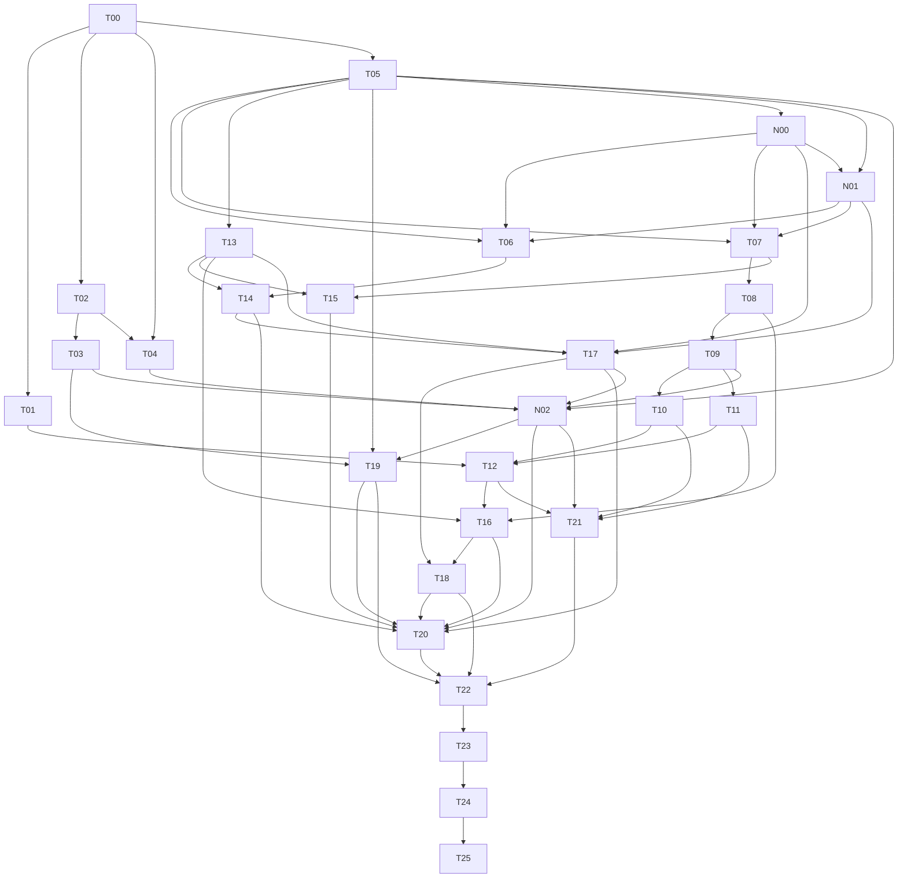
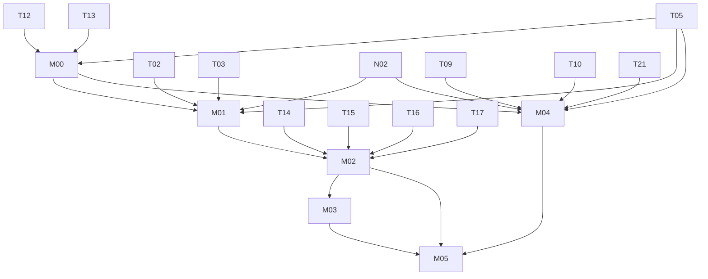

# AI 开发任务卡

桌面首版共29张卡：T00至T25保留，新增N00至N02；后续移动阶段6张卡，编号M00至M05。用户要求与范围以DEVELOPMENT_SPEC.md为准。任务完成包含真实验证与证据；实施顺序由依赖确定。

## 执行规则

1. 优先T00/T01/T05→N00/N01，形成Stremio元数据与受控MacCMS可选播放的匹配路径；T02/T03/T04与N02验证Cloudstream。G0-Core/G1支持HTTP里程碑，G0-CS/G2约束原包分支，最终验收Stremio元数据→Cloudstream主播放及MacCMS可选受控分支。
2. 每卡先阅读输入和现有代码，确定最小修改，再实施。所有模型按DATA_STRUCTURES.md、bridge.openapi.json、app.schema.json；结构变更先运行validate_contracts.py并更新合成样例。
3. 在docs/progress.md记录状态todo/doing/done/blocked、实际证据和待办。
4. 单元fixture、Android运行、真实源测试、三平台运行、发行安装分别记录。
5. 遇到外部源失败，用固定参考Cloudstream环境复核；本地实现错误保持为待修复。
6. 卡之间复用统一DTO/错误码、Tauri命令、RuntimeManager与player.ts。禁止另建第二套协议或源实现。
7. 明确失败、资源清理、取消和旧结果丢弃属于每个异步功能的验收。
8. 平台可用性：开始T00时先在docs/progress.md写出“执行环境表”，列出当前可直接操作的机器（OS/架构/虚拟化/GPU）、可用CI及需要用户提供的机器。只能在实际可操作的平台上标记运行验证通过；其他平台的条目保持blocked并写明所需机器与复现命令，交由用户执行后回填证据。托管CI通常不提供Android模拟器所需的嵌套虚拟化（Linux KVM runner除外），CI结果只能作为构建与单元测试证据，不能替代G1/G4的真实运行。
9. 需要用户本人完成的步骤（Android SDK许可接受、宿主虚拟化开启、签名证书、系统设置）由AI给出准确说明后暂停该分支，继续推进不依赖它的任务卡。

## 依赖总览

T06至T11的done按原生HTTP实现与共用合成fixture验收；涉及Cloudstream的段落为N02的接入契约。真实Ddys/SuperVod数据、七包provider实现、原loadLinks和Yjys interceptor统一在N02验收，T20/T21复测。T11先按HTTP媒体基线执行，Cloudstream新增DASH样本在N02补齐，字幕保持在范围。HTTP真实闭环可先在T16/T17完成并记录；原包分支的真实接入在N02验收，最终发行等待全部验证门。

## T00 版本与环境基线

- 对应：U01/U02/U04/U05，G0。
- 输入：全部文档、references/plugin-artifact-inventory.json、固定上游源码。
- 修改位置：application/docs/runtime.lock.json、rust-toolchain.toml、src-tauri/Cargo.lock、package-lock.json、Android依赖锁与docs/progress.md。
- 工作：记录Rust/Tauri/Vue/TypeScript/Vite/hls.js/Node/npm、Cloudstream候选提交、JDK/Gradle、emulator/tools、API35镜像revision及宿主架构。核验7包摘要并保留manifest；复核依赖许可证及发行材料。
- 通过：Core的Rust/Node/WebView工具版本、获取方式和最小构建命令明确；Android工具/镜像在同一清单单独记录计划版本与待验证状态，由T02/T04补实测；原包7/7身份静态核对。T00的Core完成条件按本句验收，Cloudstream分支独立记录，HTTP任务可继续。
- 验证：三平台环境检测记录；JSON解析与字段校验；官方工具version输出。此卡将验证计划、可用机器和实际运行结果分别记录。
- 停止条件：缺少Rust/WebView前提时暂停Core分支；SDK镜像、虚拟化或ABI前提缺失时只暂停Cloudstream分支，继续HTTP任务。

## T01 三平台 Tauri WebView 视频技术样机

- 依赖：T00；对应U01/U04，G1。
- 修改：src-tauri/src/lib.rs与main.rs、src/player.ts、最小样机Vue页、Tauri权限/CSP、packaging依赖说明。
- 工作：建立Tauri窗口，video原生/HLS.js能力检测，播放自有MP4/HLS；验证资源cap、CORS、CSP、loopback网络策略、codec、字幕、音频、暂停、seek、DPI与清理；检查360/390宽度重排。此时Android网关尚未存在：在tests/fixtures下实现最小宿主loopback测试服务器（随机端口、`?cap=`校验、固定Origin CORS、Range），只用于样机与后续回归，禁止进入正式构建。
- 通过：macOS两种目标架构、Windows x86_64、Ubuntu X11/Wayland有实际样机记录；播放界面使用Tauri WebView内嵌区域；主线程保持响应。
- 验证：自有1080p30片段、30分钟播放、20次打开/关闭、窗口缩放与全屏，记录帧表现和资源。
- 停止条件：某平台出现渲染/音频/依赖问题，提交最小复现并修复；禁止先堆业务UI掩盖技术门失败。

## T02 Android 引擎基础与原始 DEX ABI

- 依赖：T00；对应U05，G2基础。
- 修改：android-engine/upstream的固定分支、Engine入口、加载测试、运行时锁。
- 工作：复用原Application/PluginManager/网络/extractor上下文，在ART加载7个原包；记录pluginClassName、方法链接异常及注册事件。验证Android只读DEX要求由真实加载器处理。
- 启动交付：提供可安装APK、固定BootstrapActivity和最小受Bearer鉴权的GET /v1/health；响应沿用HealthEnvelope，提供engine_epoch及initializing/ready/failed状态，供T04直接使用。
- 通过：7/7未经修改原包成功load；整个包摘要一致；原API和依赖符号实际解析；原Context/Application初始化成立。
- 验证：Android instrumentation、加载报告及bootstrap/health鉴权、epoch、状态测试。对版本不兼容优先换匹配的历史运行时或补兼容ABI，并记录选择依据。
- 停止条件：NoSuchMethod/ClassNotFound等保持失败，禁止重编译原插件作为通过依据。

## T03 全部 provider 枚举与身份

- 依赖：T02；对应U02/U05。
- 修改：Android ProviderRegistry、models.rs源DTO、compatibility-report.json。
- 工作：枚举每包所有注册实例；SuperVod保留全部注册源；按数据字典长度前缀H公式生成稳定source_id与独立source_revision；采集能力和语言。
- 通过：包→provider清单完整；同名实例可区分；两次相同制品启动得到稳定身份；旧revision引用可明确拒绝。
- 验证：多源插件、同名/同class不同mainUrl、注册顺序、包更新和重启fixture；真实SuperVod注册清单。

## T04 RuntimeManager 与专用 AVD

- 依赖：T00/T02；对应U04。
- 修改：src-tauri/src/runtime.rs、src/views/SetupView.vue、平台工具定位与进程测试。
- 工作：检测环境、创建专用AVD并等待系统启动、安装T02的APK、选择自身serial、bootstrap令牌、动态ADB forward和退出回收；安装及bootstrap完成后检查health。
- 通过：三平台使用T02最小health验证桥接可达、Bearer鉴权与epoch，initializing为明确的准备状态；业务ready由后续源初始化验收。空格/中文路径可用；取消/超时清理自身资源；用户其他设备/模拟器状态保持；重启生成新epoch/令牌。
- 验证：预置其他ADB设备、端口冲突、APK安装失败、引擎崩溃、重启、取消；检查loopback监听与forward。
- 额外：实现规格5.5的可见交互模式；普通播放与窗口切换的影响由UI说明。

## T05 Rust宿主与统一命令契约

- 依赖：T00。
- 修改：SourceDispatch、宿主状态/设置、commands.rs/api.ts、DTO与契约测试。
- 工作：初始化host_epoch与Rust来源注册表，定义三类enum路由；实现runtime_status、默认application准备、get_sources、取消、Settings v2读写及v1迁移。定义17个命令，HTTP业务后续接入，Cloudstream分支由N02连接原Bridge。
- 通过：无SDK/ADB/AVD环境也可准备宿主、保存HTTP配置、枚举空/已配置来源、取消本机任务；宿主与guest_epoch有独立字段，契约fixture与权限负例通过。
- 验证：匿名配置、重复config_id、迁移、禁止URL形态、原子保存及失败、设置队列交错、旧generation晚到/删除再添加、同世代同步乱序、自身取消与重复活动UUID、父子级联取消、未知来源与UUID/状态规则。

| 命令/接口 | 行为验收任务 |
|---|---|
| Android bootstrap、GET /v1/health | T02；T04验证客体启动链 |
| runtime_status、application准备、get_sources、cancel_request、get/save_settings | T05；配置故障与退出清理由T18扩展 |
| MacCMS/Stremio协议和来源同步 | N00/N01 |
| get_home / get_details / match_playback / resolve_episode | T06 / T07 / T08 / T08 |
| open_playback、close_playback、release_resolution、get_resource_status及Rust资源服务 | T09；播放器接入T12 |
| Cloudstream准备、桥接路由、start/finish_interaction | N02；UI入口与状态fixture由T17提供 |
| Cloudstream制品刷新事务 | T19 |

## T06 推荐首页数据适配

- 依赖：T05/N00/N01。
- 修改：Rust统一home分发、HTTP映射、HomePage DTO与fixture；Cloudstream真实桥接由N02接入。
- 工作：HTTP来源按第18章取分类/catalog并映射栏目；Cloudstream映射getMainPage，保留动态mainPage与一次多栏；建立当前epoch/revision的section_ref和page；保留源给出顺序并约束has_next/next_page；sequential源串行。按开发规格7.3按来源选择单栏目/整页预算执行，全量首页的栏目失败写入failed_sections，指定单栏失败走错误包络。
- 通过：源首页栏目与数据真实映射；翻页使用正确原request数据；HTTP动态栏目及共用栏目fixture正常；全量/单栏重试/翻页范围与index保持；空/错分别返回。
- 验证：单栏、多栏、重复标题、动态栏目、page2、空页、部分栏目失败、全部栏目失败、顺序源；section_id使用identity_example向量；三类共用DTO的合成映射与聚合超时、A成功/B失败/C成功的混合顺序、单栏首屏重试保留其他栏目；真实7包provider测试在N02执行。

## T07 详情与集数规范化

- 依赖：T05/N00/N01。
- 修改：统一details分发、MacCMS/Stremio映射、Details/Episode DTO；Cloudstream真实桥接由N02接入。
- 工作：统一三类详情/集数映射；Cloudstream调用load(opaque)，HTTP来源保留站点/扩展身份；输出Movie/Series/Anime与详情rating/actors/directors/regions/status/update_label等；按实际可用元数据与空值规则输出；保留分组kind/season/dub、Episode.index及原data；注册详情/相关卡/演员/单集图片。
- 通过：URL型与JSON型ref均保持原样；集数10/2顺序正确；无季/无年份/无图正确显示；多个线路分组完整。
- 验证：HTTP多季、opaque JSON合成引用、单片、中文特殊字符、超长列表及无可播条目；真实Ddys/SuperVod在N02执行。

## T08 跨源匹配 原始loadLinks与资源登记

- 依赖：T07。
- 修改：matching.rs、match_playback应用命令、Rust resolve分发与宿主ResolutionStore、HTTP候选登记、共用DTO；Cloudstream关联在N02验证。
- 工作：先按18.6实现Stremio→选定provider匹配、手动确认、match_id绑定，再解析MacCMS候选并生成宿主句柄；Cloudstream侧执行loadLinks(...,isCasting=false)，收集回调；保留原link与provider归属、headers、referer、extractor data和interceptor。
- 通过：Resolution.episode_ref与原始episode data一致；候选顺序和名称稳定；空候选/异常/取消准确；资源按source_revision隔离；候选表可显式释放，释放后旧stream_id查找返回过期结果；引用保有契约通过合成所有权向量验证；实际Session行为由T09验收，桥接DELETE真实路径在N02验收。
- 验证：多回调、字幕、未知quality、false返回、零link（UPSTREAM_FAILED/no_links）、全部不可播放、异常、回调晚到、版本变化与45秒超时。

- 匹配验收：同名重拍/别名/年份缺失、外部ID确认、跨季/特别季/小数集、无search能力、人工选集、乱序/取消/修订变化、match_id过期，以及Stremio媒体resolve被拒绝。受控MacCMS先验收，Cloudstream真实行为在N02验收。

## T09 通用媒体与图片网关

- 依赖：T08，G3基础。
- 修改：Rust MediaGateway/ImageGateway及宿主会话记录、HTTP fixtures；Android已有网关由N02复用。
- 工作：创建带resolution/stream/source_revision/episode_ref/stream_kind绑定的PlaybackSession与media_capability；ImageRef单资源cap/到期；CORS与查询串脱敏；资源ID映射；HTTP来源在Rust来源上下文执行，Cloudstream保留原provider interceptor；流式返回；转发Range、处理重定向、修正响应头、取消上游。
- 通过：HTTP fixture要求的Cookie/Referer真正参与；本地令牌留在网关；200/206/416语义正确；大流保持有界内存。
- 验证：Header/Cookie要求、Range/If-Range、gzip、重定向、断开、慢响应、HTML错误、超限图片；session410与取消、同集换线路保留候选、旧close/release晚到保持新会话/新解析、无Session离页显式释放候选、使用可控时钟验证活动流超过5分钟及候选表回收后的独立请求上下文读取、get_resource_status的ready/expired/failed与世代转换、实际连接公网校验/私网重定向/DNS重绑定。

## T10 HLS 代理保真

- 依赖：T09，G3。
- 修改：HLS清单解析/重写、resource登记、测试素材。
- 工作：主/媒体清单、音轨、字幕、key、init、相对/绝对URI、byterange、重定向基址、序列/连续性；HTTP先执行所属来源响应处理再重写，Cloudstream原interceptor顺序在N02验证。
- 通过：所有下游请求继续经过同一网关及原源上下文；AES-128、fMP4、相对URL和查询签名正确；无任意URL开放代理。
- 验证：每项独立fixture+组合播放；HTTP清单变换与重写顺序fixture；真实Yjys特殊拦截器在N02回归；请求日志证明key/segment也走代理；可控时钟跨5分钟与释放Resolution后继续刷新HLS/读取Key/分片。

## T11 字幕与基线 DASH

- 依赖：T09。
- 修改：字幕resource、播放器字幕接入、必要的MPD结构化处理。
- 工作：VTT轨道，SRT/ASS结构化转换为VTT基础文本与鉴权；若基线输出DASH，处理BaseURL、SegmentList、SegmentBase、受约束模板展开。
- 通过：字幕可开关和切换，旧会话释放；基线DASH样本可播放/seek；DRM资源给出准确类型错误。
- 验证：字幕Header/Cookie、时间轴、切集、query、模板Number/Time/RepresentationID、非法模板参数；Resolution回收后字幕继续加载。
- 记录：基线DASH是否实际出现及其制品证据；未出现的类型标记为未验证。

## T12 正式 WebView 播放控制

- 依赖：T01/T10，T11按媒体基线接入。
- 修改：src/player.ts、PlaybackView.vue与播放行为测试。
- 工作：使用PlaybackViewSession的stream_kind/URL及episode绑定，按PlayerEvent/PlaybackState契约接入video/HLS事件、准备/缓冲/位置/EOS/错误、autoplay交互、资源清理与playback_epoch。
- 通过：位置事件合理合并；切流销毁HLS/track/监听并释放音频与HTTP；旧epoch事件丢弃；duration unknown可正确呈现；原生video/img/track的错误经状态查询按10.5恢复。
- 验证：50次切集、暂停seek、EOS、源失联、会话过期、图片LRU过期、401/502/解码失败区分、查询失败/旧查询晚到、CPU/内存与媒体资源回收。

## T13 应用状态与导航

- 依赖：T05。
- 修改：src/state.ts、App.vue、api.ts、导航测试及src-tauri公共入口。
- 工作：app.schema.json定义的Vue AppState/Route/SourcesState/页面状态/PlaybackContext/PlaybackState.resolution、source/request/playback epoch、返回恢复、源选择状态；首页分页合并按开发规格11.1；Rust管理环境与会话，桌面模块cfg隔离。
- 通过：快切A/B、源切换、返回及引擎重启的状态一致；渲染过程保持无阻塞副作用，移动公共入口可检查。
- 验证：乱序响应、路由/上下文/详情集数/Resolution/Session绑定及非法候选负例、模态焦点、快捷键上下文、最小窗口和高DPI。

- 语言补充：按开发规格18.3.1建立英文基础文案与中文词典、顶部/设置页切换；ui_locale缺省en并经Settings队列持久化。验证中英文路由/筛选/选集稳定、文档lang/title/无障碍名称、存储失败、390px重排及播放中切换。

- 外观补充：基础UI采用Naive UI 2.45.3，UiProvider为唯一库配置；useOsTheme响应系统明暗，内置lightTheme/darkTheme及themeOverrides统一页面与控件。用户选择五种color_palette之一，缺省lime，按Settings队列持久化；首帧恢复色系，旧ui_theme仅兼容且忽略。验证五色系×明暗/双语/390px、系统运行中切换、导航/表单/错误/弹层/海报/播放器对比度，色系变更保留播放与筛选，存储失败明确反馈。

- 历史补充：增加#/history导航与HistoryView，按影片合并、最近时间分组、当前集进度与来源、续播/重播、单条删除和清空确认；预览使用会话内数据，明确刷新重置。正式SQLite持久化由T18接入，按开发规格11.4恢复稳定内容/video身份。

## T14 推荐首页界面

- 依赖：T06/T13。
- 修改：src/views/HomeView.vue、海报卡与栏目分页。
- 工作：真实栏目、骨架、分页、滚动恢复、有限图片缓存、错误/空页与重试；failed_sections在原栏目位置显示错误与单栏重试；首次启动按1.2独立恢复元数据配置与播放源，元数据默认选择只要求Stremio home/details。
- 通过：所选Stremio配置进入对应首页，播放源变化保留元数据首页；长列表与无图/长标题可读；返回恢复位置。
- 验证：多栏目、数百卡片、重复项、失败重试、过期图片资源、窗口宽度变化。

## T15 详情与选集界面

- 依赖：T07/T13。
- 修改：src/views/DetailsView.vue、分组和集数控件。
- 工作：标题/海报/简介/元数据、单片播放、多季/线路网格、相关内容。
- 通过：选中项与实际Episode.ref对应；换组明确；字段缺失自然呈现；旧详情响应无法覆盖新页。
- 验证：Movie/Series/Anime、多源语义分组、200集、重复集名、空可播列表。

## T16 内嵌播放界面

- 依赖：T08/T12/T13。
- 修改：src/views/PlaybackView.vue、控制栏、线路/集数/字幕浮层。
- 工作：实际事件驱动控制；暂停、seek、音量、倍速、全屏、选集、下一集；隐藏控制和键盘操作。
- 通过：视频区内嵌、音画正常；所有状态反映真实管线；EOS自动下一集受当前epoch与选项约束。
- 验证：键鼠/焦点、缩放/DPI、全屏恢复、末集、网络错/缓冲、字幕和线路切换。

- 历史补充：按11.4捕获播放快照，周期及暂停/seek/切集/离页更新；恢复进度等待媒体metadata，记录来源与影片身份，防止旧播放事件写到新集。

## T17 源选择 引擎设置与受控交互

- 依赖：T13/T14/N00/N01。
- 修改：src/views/SourcesView.vue、src/views/SetupView.vue、诊断UI、必要的Android交互入口。
- 工作：元数据配置与播放源独立选择，MacCMS URL与Stremio manifest列表的新增/编辑/禁用/删除，按kind展示状态；Cloudstream按包展示与准备/诊断入口；初始化错误与修复指引；INTERACTION_REQUIRED的可见引擎流程。T17使用合成状态fixture完成交互UI，真实人机验证响应的采样与判定在N02验收；判定不出的情况保持UPSTREAM_FAILED。
- 通过：HTTP配置与真实首页可操作；Cloudstream准备、源列表与交互入口用状态fixture验证；真实SuperVod全集与可见交互由N02验收。宿主/客体状态分开，诊断脱敏。
- 验证：HTTP配置行为与Cloudstream交互状态fixture、拒绝/取消、复制诊断；真实客体重启和HTTP播放持续在N02复测。

## T18 设置与全生命周期清理

- 依赖：T16/T17。
- 修改：src-tauri/src/settings.rs、history.rs、前端卸载/关闭与崩溃恢复测试。
- 工作：延续T05的Settings v2及v1迁移，验证source_configs和音量/auto_next/窗口/最近源；原子写入；schema_version与损坏恢复；前后台ResumeSnapshot仅驻留内存；取消全链；自身进程、forward、流与图像清理。
- 通过：退出后无本项目残余媒体声/请求；用户其他ADB状态保留；配置异常可定位；重启状态合理。
- 验证：写入中断、权限错误、中文目录、kill/relaunch、窗口关闭、连续50次切换。

- SQLite补充：按11.4实现Rust本地历史仓储与迁移；先同步机器DTO、IPC和样例，再替换前端history数据入口。验证跨重启、迁移失败、磁盘/权限错误、原子更新、乱序写入、删除/清空与待写快照、退出写队列；Settings v2维持JSON兼容。

## T19 索引刷新与制品事务

- 依赖：T03/T05/N02。
- 修改：Android catalog同步、制品锁和回滚逻辑。
- 工作：可选字段、未知字段、版本/摘要、ZIP防穿越、原包保存、安装事务、旧revision隔离。
- 通过：7包基线保持原字节；刷新失败保留前一完整状态；新API版本有显式错误；所有注册源映射可追溯。
- 验证：断网、中断包、同版本不同字节、缺字段、恶意路径/ZIP、取消、无变更/暂存失败维持播放、变更提交前停止受影响包全部会话、提交回滚后保持停止并可重新解析、其他包/HTTP播放持续。

## T20 原包兼容与产品端到端

- 依赖：T14/T15/T16/T17/T18/T19/N02，G2/G4。
- 修改：Android instrumentation、tests/e2e、compatibility-report.json。
- 工作：三平台完成Stremio元数据→Cloudstream主播放，受控MacCMS样本完成可选播放分支；HTTP-only冷启动与Cloudstream故障隔离；7包加载与注册全集；每个已注册provider声明能力的home/search/details/resolve契约，通用实现使用参数化fixture逐实例执行；各独立interceptor行为；真实可用源闭环。
- 通过：三平台元数据/主播放匹配闭环及可选MacCMS受控验收；HTTP功能在未安装Android环境时可用，Cloudstream仍按原包基线验收；每包有正确证据；源站失败有相同参考环境复核。
- 验证：本规格14章矩阵；记录制品、源/内容、平台、网络环境、日期、结果和关联日志。

- 历史补充：三平台真实SQLite重启与续播，包含跨季video id、换源重新匹配、当前集结束与自动下一集、来源失效、明暗/双语/390px，以及失败后保留原记录。

## T21 媒体网关与鉴权回归

- 依赖：T10/T11/T12/N02。
- 修改：tests/contract、Rust及Android两处gateway tests与共用自有媒体集合。
- 工作：自动验证清单/Key/分片、header、Cookie、Range、重定向、body修改、取消、图片cap到期所属DTO刷新、播放滑动租约、cap到期/撤销、大小限制、跨session隔离，以及Tauri命令权限/CSP/CORS负例。
- 通过：三平台播放器访问同一受控媒体集合；每条子请求可关联会话；任意URL/路径输入被拒绝；本地令牌不会出现在上游。
- 验证：包络与资源权限负例，过期引用，非法模板输入，超大body/图像，慢流背压和30分钟播放。

## T22 三平台性能与故障注入

- 依赖：T18/T19/T20/T21。
- 修改：证据与必要的局部修复。
- 工作：测量参考机启动、AVD、代理吞吐、1080p30、切集/缩放、WebView媒体资源、CPU/RSS；注入网络/引擎/文件故障。
- 通过：本规格性能目标达到或有可复现的明确差距及修复；关键可靠性问题清零。
- 验证：每平台独立报告；先定位再优化，避免无关重构与提前引入新播放后端。

## T23 发行安装包

- 依赖：T22，G5。
- 修改：packaging三目录、SDK初始化资源清单、版本锁、许可证/源码说明。
- 工作：Tauri构建与本地前端资源、WebView2初始化、WebKitGTK/媒体codec依赖、引擎APK、SDK/镜像获取、macOS签名/公证、Windows签名策略、Linux依赖与入口；无运行期CDN脚本依赖。
- 通过：干净系统按README安装运行；无开发机绝对路径依赖；普通启动保持系统安全设置；工具前提准确展示。
- 验证：每平台干净机器安装/初始化/首播/升级/卸载；无签名凭据时准确记录发行阻塞，禁止声称已签名。

## T24 独立验收与问题修复

- 依赖：T23。
- 修改：必要修复与最终证据。
- 工作：按U01至U06及U08/U09、G0-Core/G0-CS至G5完整审查，并检查U07的移动公共入口/平台隔离/响应式布局与实施计划；核对原包摘要、注册全集、媒体代理、实际平台运行与安装包。
- 通过：每个硬条件有证据；已知失败可准确归因；文档与最终实现一致；高影响问题清零。
- 验证：按行为复测，避免仅复制实现细节；结论包含实际测试命令和结果。
- 执行：可由独立审查步骤或明确授权的审查agent执行，避免开发者自行省略关键验收。

## T25 开发交付与最终说明

- 依赖：T24。
- 修改：application/README.md、docs/progress.md、release-evidence、最终版本锁。
- 工作：重写README围绕最终实现给出构建、运行、测试、依赖初始化、诊断及发布状态；列出实际保留限制。
- 通过：另一开发AI可从全新目录按说明复现；任务状态与证据对应；三平台发行材料和原包基线可追溯。
- 最终报告：Changed / Why / Verified / Remaining，附安装包、源码、版本锁和验收报告路径。

## 硬性完成判据

T00至T25及N00至N02的done均需满足卡内通过条件。mock/fixture阶段、原包静态检查、实际运行与真实源在线结果必须分开标记。桌面首版完成需要U01至U06及U08/U09、U07首版结构要求、N00至N02和全部G验证门通过，或准确报告仍阻塞的具体要求与证据。

## N00 MacCMS JSON来源

- 依赖：T05。
- 对应：U08；修改src-tauri/src/maccms.rs、来源配置、HTTP fixture与身份向量。
- 工作：按开发规格18.2实现匿名JSON分类/分页/详情/搜索能力；播放分组与集数拆分；URL/headers保留原语义，生成规范引用；同步不启动Android。
- 通过：一个受控MacCMS JSON服务的完整数据映射正确；多组、多集、空结果、关闭接口、错误code、非JSON、歧义分组有准确结果；配置ID稳定，修订变化可失效缓存。
- 验证：协议向量、非数字页码、Unicode、URL中$及#编码、HTML播放页、超限、取消、重定向目标、禁用/删除；真实源闭环在T20记录。

## N01 Stremio HTTP来源

- 依赖：T05/N00。
- 对应：U08；修改src-tauri/src/stremio.rs、manifest/资源HTTP及fixture。
- 工作：一个配置组合多个manifest；保留配置路径前缀，catalog分页与meta/videos元数据映射；资源字符串与对象过滤，stream及inline streams保持忽略，resolve能力固定false。
- 通过：catalog/meta扩展组成元数据模型；stream-only配置显示缺少元数据能力；同名catalog独立，原video_id准确，按配置顺序展示；元数据部分失败与全部失败按规范处理。
- 验证：types/idPrefixes、required extras、skip/空页、扩展顺序、对象资源、无videos电影、inline streams与infoHash/ytId字段被忽略、不可信元数据地址、Cookie/headers、取消；manifest首次部分失败/刷新失败保留旧快照/配置编辑撤销、meta回退与部分失败warnings、catalog/meta配置可自动成为元数据源，其inline/stream字段不进入播放管线、45秒聚合预算与取消；协议向量保持合成标记。

- 语言补充：按18.3.1验证选定Stremio metadata扩展的en/zh-CN确切配置及请求，保留英文基础ID/引用，本地化同ID展示字段；覆盖中文缺失/失败回退、ja/fr映射en、分语言缓存和中→英→中乱序；记录真实元数据证据。

## N02 Cloudstream接入统一宿主

- 依赖：T03/T04/T05/T09/T17。
- 对应：U05/U08，G2；修改EngineClient、SourceDispatch后端映射、来源UI及运行状态。
- 工作：采集真实源站人机验证响应并固化状态码/响应特征fixture，实现规格5.5判定；复用APK与原桥接；AppSource.kind=cloudstream，保留所有注册provider；将客体section/resolve/stream/session ID映射为宿主句柄；显式准备Android并接入受控可见交互。
- 通过：7/7原包、全部注册源和真实原拦截器路径保持；guest_epoch变化只失效Cloudstream资源，HTTP来源仍可播放；start_interaction的应用结果携带host_epoch，客体新epoch在runtime.cloudstream事件中体现。
- 验证：无Android时HTTP冷启动、客体启动/崩溃/重启、同名后端ID、过期句柄、原包更新、SuperVod全集及动态栏目、Ddys多季/原Vod JSON、七包provider代表场景、原Cookie/Referer/Yjys interceptor及loadLinks、桥接DELETE后活动会话存活、客体资源状态查询、可见交互、取消与全链退出。真实源失败按原参考环境复核。

## 后续移动任务依赖

M系列依据开发规格第16章实施，版本/权限与发行要求在执行时再次核对。M00可在稳定契约后进行小型验证，移动产品集成安排在桌面首版完成后。以下交付物按需创建，先复用已有运行时、DTO与页面。

## M00 Android / iOS 真机可行性与版本基线

- 依赖：T05/T12/T13；对应U07，MG0。
- 修改：Tauri工具生成的Android/iOS目录、最小移动配置、docs/mobile-baseline.json与证据。
- 工作：先构建真机Stremio元数据→受控MacCMS可选播放匹配闭环；HTTP与匹配复用Rust。再构建原包分支真机壳；确定最低OS、Rust targets、JDK/NDK/Xcode与设备矩阵；测video/HLS/HTTPS、Origin/CSP/CORS、safe area、旋转与暂停恢复。Android额外安装同机引擎验证原包7/7；iOS验证受信远程引擎的可达性与播放样机。
- 通过：两平台真实设备版本与运行结果明确；Kotlin绑定服务路径、iOS远程执行位置与组件要求固定；未通过项有最小复现。
- 验证：干净真机安装、媒体样本、7包加载证据与基础生命周期录像。
- 停止条件：某平台工具链、运行环境或媒体路径缺失，保持该平台门未通过；先解决具体前提。

## M01 Android 同机引擎与 Kotlin 接入

- 依赖：M00/T02/T03/T05/N02；对应MG1基础。
- 修改：Tauri Kotlin原生插件、引擎显式绑定Service/signature权限、Rust Android启动路径。
- 工作：同签名主应用与独立引擎APK；绑定bootstrap令牌/epoch/端口；校验包/签名/版本；复用EngineClient与资源cap；保留上游Application初始化；cfg排除AVD/ADB代码。
- 通过：Android本机原包7/7与全部provider可调用；第三方签名绑定被拒绝；服务断开可恢复；控制令牌停留原生层。
- 验证：缺组件、签名错、版本错、进程回收、绑定重连、第三方伪造与原包摘要。

## M02 移动页面与播放器适配

- 依赖：M01/T14/T15/T16/T17。
- 修改：共用Vue/CSS、player.ts与必要原生能力插件。
- 工作：safe area、360/390/768布局、触控控制、playsinline、系统返回、横竖屏、音频中断、前后台暂停恢复、源站EngineActivity交互。
- 通过：Android首页→详情→选集→播放→切集全部真实；共用桌面布局回归通过；旧epoch/资源清理准确。
- 验证：窄屏、长标题、200集、弱网、Wi-Fi/蜂窝切换、来电/耳机、后台回收、交互取消与重试。

## M03 Android 安装与发行验收

- 依赖：M02；对应MG1/MG3。
- 修改：主应用/引擎APK签名构建、组件初始化说明、版本配套清单。
- 工作：干净真机双组件安装、权限、首次加载、升级错配、卸载；记录发行渠道与原始插件动态加载相关要求的实际核对结果。
- 通过：签名与组件版本配套可复现；7包/全部源/媒体闭环证据完整；初始化步骤向用户清楚展示。
- 验证：支持矩阵内真机全流程、进程回收恢复与签名负例；发行材料缺项准确列为待办。

## M04 iOS 配对远程兼容引擎

- 依赖：M00/T05/T09/T10/T21/N02；对应MG2基础。
- 修改：受信HTTPS网关部署、Rust配对/凭据存储、iOS连接设置、会话隔离及协议版本扩展。
- 工作：明确用户管理的Android引擎位置；HTTPS身份校验、配对/撤销、独立客户端session、媒体base与cap重写；保留同一DEX与interceptor链。远程部署模式单独配置，桌面本地默认维持loopback。
- 通过：iPhone通过配对引擎取得真实首页/详情/媒体；坏证书/未配对/跨会话访问被拒绝；控制凭据保持原生层；断线可恢复。
- 验证：真实iPhone与受控网络、多客户端隔离、TLS负例、撤销、弱网、HLS全部子资源、字幕/Range与流式内存。

## M05 iOS 真机闭环与移动最终交付

- 依赖：M03/M04/M02；对应MG2/MG3。
- 修改：必要Swift插件、iOS配置/签名、移动说明与证据。
- 工作：iPhone safe area/旋转/音频中断/前后台/系统返回；远程引擎初始化与离线恢复；复核当前发行渠道要求并形成签名安装包与发布状态清单。
- 通过：iOS真机推荐→详情→选集→播放→切集，TLS/配对/跨客户端隔离与生命周期验收通过；文档清楚说明引擎设备和联网前提。
- 验证：支持矩阵真实设备全流程，记录版本/命令/结果；Android与桌面公共代码回归。移动完成报告附MG0至MG3证据和实际发行状态。
