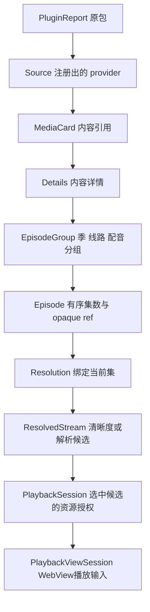

# 数据结构、原 App 映射与契约审查

版本1.5.0，日期2026-10-26。适用范围：Tauri 2 + Rust、桌面三平台首版、MacCMS/Stremio及全部原始cs3兼容，以及后续Android/iOS的共用业务结构。

## 1 审查修订记录

1.5.0按最新设定收敛产品：Stremio元数据，Cloudstream主播放，MacCMS可选；新增MetadataIdentity/MetadataRef、match_playback与跨源PlaybackContext，原provider内容/集数引用继续同源。WatchHistoryRecord明确元数据来源和规范身份；历史持久化由T18实施，T20依赖T18。

1.4.0修订：会话关闭与候选释放分别调用；首页按请求范围合并并保留index；Cloudstream变更提交前停止受影响会话；补齐T17/T21前提、meta内联解析能力及播放上下文语义检查。HomeSection/HomeSectionFailure新增必需index，新增第16个命令release_resolution；首次实现以此契约快照同步生成Rust/Kotlin/TypeScript DTO，Settings仍为v2。

| 优先级 | 修订前问题 | 本次修订 |
|---|---|---|
| P1 | 播放会话与解析结果的网络上下文所有权缺失 | Session独立保有LinkRecord，候选回收后继续播放 |
| P1 | 异步配置结果缺少提交顺序 | 单写队列、config_generation与sync_sequence核对后提交 |
| P1 | HTTP里程碑含后续Cloudstream验收 | 原包场景移至N02，HTTP任务按自身能力完成 |
| P1 | 公共URL校验未约束实际连接 | DNS/peer绑定、逐跳重定向与统一出站入口 |
| P2 | 请求预算跨层优先级与传播缺失 | 操作预算表、剩余时长头及客户端传输余量 |
| P2 | 正例允许取消自身 | 修正ID，增加跨字段语义检查及父子任务取消规则 |
| P2 | Stremio部分失败缺少完整契约 | manifest完整快照事务及Details/Resolution.warnings |
| P2 | 原生媒体错误缺少业务诊断通道 | get_resource_status与明确的过期/失败恢复规则 |
| P1 | 首启健康检查早于APK安装 | 固定系统启动、安装、bootstrap、转发、健康检查的顺序 |
| P1 | T04需要的APK与health缺少前置交付 | T02提供最小接口，T04依赖T02；后续命令按所属任务验收 |
| P1 | registration_key同时被描述为JSON数组与摘要 | 统一为H公式产生的64位小写十六进制摘要 |
| P1 | 引擎业务成功结果允许空epoch | 成功结果强制UUID，本机准备/设置/取消按上下文允许空值 |
| P2 | 内嵌播放示例的源归属矛盾 | 校正示例，对内嵌及正向fixture递归检查源/修订绑定 |
| P2 | ready运行状态允许failed健康状态 | phase=ready时health.status固定为ready，并补负例 |
| P2 | 契约检查依赖分析机绝对样本路径 | 默认独立校验契约；--artifact-root显式启用原样本字节复核 |
| P2 | 开发规格与Schema使用两套AppState字段名 | 统一route/selected_metadata_source/selected_playback_source/runtime/home/details/playback/settings并自动核对 |

1.3.1补齐会话所有权、配置提交世代、请求预算、出站连接校验、取消身份、Stremio完整快照/部分失败诊断、资源状态查询与任务验收顺序；继承1.3.0的三类来源AppSource联合、HTTP配置、宿主状态及独立Cloudstream状态，沿用1.2.2的失败栏目、身份向量、交互诊断、图片租约、来源列表和解析状态。bridge.openapi.json仍定义Android客体HTTP与共用内容DTO；app.schema.json定义应用层多来源结构。Settings.schema_version升级为2并定义v1迁移，Health.api_version保持客体控制主版本"1"。新增结构见第13节与开发规格第18章。

## 2 阅读入口与唯一结构来源

- [bridge.openapi.json](bridge.openapi.json)：Rust与Android引擎的HTTP DTO、端点、资源授权与错误。
- [app.schema.json](app.schema.json)：Tauri invoke参数/结果、事件、Settings、AppState与播放状态；直接引用桥接DTO。
- [合成契约样例](examples/contract-cases.json)：推荐→详情→选集→解析→播放的完整结构、17组命令输入/结果与非法样例。
- [原App字段证据](references/app-data-evidence.json)：E01至E13的文件摘要、零起始UTF-8字节范围、原文与解释。
- [REA选定证据视图](references/app-model-rea-evidence.json)：完整摘要视图与Detail模块视图。

本文解释字段含义与跨字段规则。新增字段先更新对应机器契约，再更新样例、本文与任务验收。HTTP DTO在Rust、Kotlin、TypeScript保持snake_case。前端布局状态与原生运行对象各自有明确归属。

## 3 原 App 的可观察结构与新项目映射

本次全程离线读取现有提取目录，原App保持未执行状态。REA分析4个选定JS文件，解析失败0；其图覆盖为partial，665个文件留在该次选定分析之外。E03/E11/E12另通过原文件字节读取核对。动态属性、服务端完整响应、字段实际空值分布仍需运行证据。

| 证据 | 原App消费字段/结构 | 可确认语义 | 新项目对应 |
|---|---|---|---|
| E01 | 卡片id、cover、name | 内容路由键、封面、名称；组件接受String/Number ID | MediaCard.id/poster/title |
| E02/E03 | 分类id/name；栏目page/videos/count/loading | 分类导航、按栏目分页；loading/page缓存由页面维护 | Source/HomeSection；HomeState独立维护加载状态 |
| E04 | score | 原文直接展示，数值类型和评分刻度待响应采样 | Rating.value/scale，刻度明确后转换 |
| E04/E13 | category[].title、types[].name | 分类/类型展示标签 | Details.tags，保留源顺序 |
| E04 | actors[].name、directors[].name | 演员/导演文字列表 | actors/directors中的PersonCredit |
| E04 | area、year、description | 地区、年份、简介展示 | regions/year/plot |
| E05 | finished、mask | 完结条件与更新提示文字 | status/update_label；总集数由源明确提供 |
| E06/E07 | source_list_source[]、每组id/name/source_list[] | 详情中的可切换播放分组与有序条目 | EpisodeGroup及Episode |
| E07/E09 | source_list[].weight | 原App使用该值选择、恢复当前集 | Episode.id/index/ref；原weight保留在源不透明数据语义中 |
| E08 | source_list[].url | 资源引用，HTTP与待解析资源走不同处理 | Episode.ref.data → resolve → ResolvedStream |
| E08/E11 | 播放器sources[]与srcs[] | 播放器输入独立于详情对象 | PlaybackContext与PlaybackViewSession |
| E09/E12 | sourceId/episodeId、进度、volume | 选择恢复、进度事件、音量设置 | PlaybackContext/ResumeSnapshot/Settings |
| E08 | time_data.titles_duration/trailer_duration | 播放器消费片头/片尾提示 | 保留为源能力观察，后续按实际功能需求扩展 |

E04/E13分别保存详情元数据和类型标签循环的精确片段。字段消费代码支持以上关系；本项目枚举、默认值、ID公式与毫秒单位为新契约设计。原App的账户、商业与传输附加字段按原有产品范围处理。

## 4 五级关系与数据流



一包可注册多个provider；一个内容可有多个分组；一集可解析多个清晰度/媒体候选。source_id标识provider实例，group_id标识详情分组，episode_id标识组内条目，stream_id标识一次解析中的候选。原App外层source命名通过上述映射落到分组。

示例过程：get_home返回HomeViewData；点卡片用原MediaRef调用get_details；选组与集形成PlaybackContext；resolve_episode取得绑定该episode_ref的Resolution；用户选择stream_id；open_playback创建Session并返回PlaybackViewSession；video/hls.js消费media_url；切集停止旧播放器、按捕获ID关闭旧session并release_resolution，再重新解析；同集换线路保留候选表。

## 5 身份、作用域与原数据保真

### 5.1 Cloudstream基线与共用摘要公式

ID由引擎生成，客户端按不透明字符串保存和回传。定义H(tag, parts...)：

```text
input = UTF8(tag) || 0x00
for each part:
    bytes = UTF8(part)
    input += uint32_big_endian(byte_length(bytes)) || bytes
H = lowercase_hex(SHA256(input))
```

所有part均为字符串；序号采用无前导零的十进制ASCII。字符串使用原Unicode编码内容，保持大小写及空白；长度采用UTF-8字节。uint32长度溢出时明确失败。

```text
registration_key = H("registration", qualified_provider_class, initial_main_url, duplicate_ordinal)
source_id         = H("source", plugin_internal_name, registration_key)
source_revision   = H("revision", plugin_sha256, cloudstream_commit, mapping_version)
content_id        = H("content", source_id, original_content_data)
group_id          = H("group", content_id, source_revision, group_index, title, kind,
                      season_number_or_empty, dub_status)
episode_id        = H("episode", content_id, source_revision, group_id, episode_index,
                      original_episode_data)
section_id        = H("section", source_id, source_revision, mainpage_name,
                      mainpage_data, duplicate_section_ordinal)
```

mainpage_name/mainpage_data取自provider.mainPage中MainPageData的name与data原字符串；duplicate_section_ordinal只区分name与data都相同的重复条目，从0起。qualified_provider_class与initial_main_url从原始注册实例读取；duplicate_ordinal只区分同class同mainUrl的重复实例，从0起。注册时值记录在清单，运行中的域名重定向保持资源行为。mapping_version在会改变映射语义时显式递增。[合成契约样例](examples/contract-cases.json)的identity_example给出全部7个公式的输入与期望摘要，Kotlin实现的单元测试应直接复用这些向量。样例其余对象中的id、section_id、group_id等只是满足格式的占位值，不能用作公式验证向量。

registration_key线格式固定为64位小写十六进制摘要。哈希输入中的类名、URL、序号按上述长度前缀编码；Source直接传输摘要，source_id再使用该摘要字符串作为输入。

内容身份可在同一逻辑provider修订后保持稳定；MediaRef仍必须带当前source_revision。分组/集数身份包含修订及源顺序，同一data多次出现时保留不同UI条目。重新加载后按ID验证选择；缺失项显示当前可用选项。播放候选身份使用以上provider公式；产品Stremio影片使用18.6的规范元数据content_id。Settings分别保存last_metadata_config_id与last_playback_source_key，启动后重新取得修订；last_source_key兼容迁移。

### 5.2 原始引用规则

MediaRef.data保存provider原始字符串。详情请求保留卡片原ref；LoadResponse中的url/uniqueUrl可供引擎处理，但内容身份依据进入该详情的原ref。Episode.ref.data保存原Episode.data，Movie映射为一个条目。无论字符串为URL或JSON，传输保持原内容。

maxLength检查Unicode字符数；引擎还须检查UTF-8长度≤524288字节。中文/emoji分别验证超字节情况。元数据请求体1MiB与响应8MiB上限继续执行；512KiB为单项引用上限，全部编码后的请求仍受请求体上限约束。批量大集数结果超限时报告RESOURCE_LIMIT并附脱敏规模诊断，避免静默截断。

应用收到的section_ref、resolution_id、stream_id、session_id是Rust宿主句柄，绑定host_epoch；Cloudstream客体返回的原ID另绑定guest_epoch，由Rust记录映射。HTTP来源在Rust内存登记相同生命周期。section_ref另绑定source_id/revision和原MainPage请求，过期后重新加载首页。旧ref的revision不匹配返回REVISION_MISMATCH；已鉴权但过期session/resource返回SESSION_EXPIRED。

## 6 值、空值与单位

| 类别 | 约定 |
|---|---|
| 展示文本 | title/label保留源文字；plot/name/role按纯文本呈现，HTML来源先结构化提取文本 |
| 未知单值 | 可空字段为null；可选字段缺失按同样的未知语义处理 |
| 集合 | 无条目/未提供集合采用[]；保持源顺序；字段存在性与业务错误分别处理 |
| 年份 | 四位已确认年份；无效或未知为null |
| 评分 | Rating整体为null或{value:0..10,scale:10}；用锁定runtime评分转换方法；刻度未知时保留未知 |
| 时间 | position_ms/duration_ms/缓冲区使用非负毫秒安全整数；浏览器seconds四舍五入转换；NaN/Infinity等未知时长为null |
| 日期 | expires_at/released_at为带时区RFC3339；输出使用UTC；单位/时区无法确认的源日期留空 |
| 音量 | Settings/PlaybackState统一0..1，muted单独存储 |
| 倍速 | 0.25..4；实际平台是否支持给定值通过播放器事件确认 |
| 集号 | number可为小数；season=0可表达源明确特殊季；index为组内零起始顺序 |
| 计数 | episode_count表达源明确总集数；已取得条目数量直接从episodes计算 |
| 数据边界 | JSON数值为有限值；所有epoch计数和毫秒不超过2^53-1；大对象按原有限额失败 |

ContentStatus：ongoing/completed/upcoming/unknown。provider未明确状态时采用unknown；update_label可独立保留源更新文字。rating=0仅在源明确给出有效零分时使用。

PersonCredit只承载源明确提供的人名、角色和照片。Cloudstream通用LoadResponse有演员能力；导演、地区、语言按已验证provider可用字段映射，缺失时保留空集合。此过程按同一provider数据完成，避免为补齐显示字段增加额外外站请求。

## 7 桥接字段速查

以下表格从本次机器契约提取。必需表示结构校验要求；可选字段按第6节处理。枚举与条件约束以bridge.openapi.json为准。

### MediaRef

| 字段 | 类型 | 必需 | 说明 |
|---|---|---|---|
| source_id | string | 是 | 确定性provider实例ID |
| source_revision | string | 是 | 插件制品与运行时映射修订 |
| data | string | 是 | 原始provider不透明字符串；maxLength约束Unicode字符数，服务端另外验证UTF-8编码长度<=524288字节。保持原内容；禁止URL重写/JSON重序列化。 |

### Source（Android桥接）

| 字段 | 类型 | 必需 | 说明 |
|---|---|---|---|
| id | string | 是 | 确定性provider实例ID |
| source_revision | string | 是 | 插件SHA256、Cloudstream runtime commit、mapping_version决定的修订摘要 |
| plugin_internal_name | string | 是 | 原包internalName |
| plugin_sha256 | string | 是 | 制品摘要 |
| registration_key | string | 是 | H("registration", class, initial_main_url, duplicate_ordinal)生成的64位小写十六进制摘要，编码见第5节 |
| name | string | 是 | 源显示名 |
| language | string | 是 | 源语言 |
| content_types | string[] | 是 |  |
| capabilities | Capabilities | 是 |  |
| runtime_status | ready / failed | 是 |  |
| error | ApiError / null | 否 |  |

### MediaCard

| 字段 | 类型 | 必需 | 说明 |
|---|---|---|---|
| id | string | 是 | 内容稳定摘要ID |
| ref | MediaRef | 是 |  |
| title | string | 是 | 标题 |
| poster | ImageRef / null | 否 |  |
| kind | movie / series / anime / other | 是 |  |
| subtitle | string / null | 否 | 年份/更新等辅助文字 |
| year | integer / null | 否 |  |
| rating | Rating / null | 否 |  |
| status | ContentStatus | 否 |  |
| update_label | string / null | 否 | 源明确提供的更新/完结展示文本 |
| episode_count | integer / null | 否 | 源明确提供的总集数 |
| quality_label | string / null | 否 | 原质量展示标签，不参与集数ID解析 |
| provider_type | string / null | 否 | 源原始TvType名称 |

### HomeRequest

| 字段 | 类型 | 必需 | 说明 |
|---|---|---|---|
| source_id | string | 是 | 确定性provider实例ID |
| source_revision | string | 是 | 插件制品与运行时映射修订 |
| section_ref | string / null | 否 | 当前engine_epoch和source_revision登记的栏目引用；缺省/null仅配page=1表示全量；非空配page=1为单栏重试，page>=2为翻页 |
| page | integer | 是 |  |

### HomePage

| 字段 | 类型 | 必需 | 说明 |
|---|---|---|---|
| source_id | string | 是 | 确定性provider实例ID |
| source_revision | string | 是 | 插件制品与运行时映射修订 |
| sections | HomeSection[] | 是 | 成功栏目，保持原mainPage顺序 |
| failed_sections | HomeSectionFailure[] | 是 | 全量首页中的失败栏目{index,title,section_ref,error}；与成功栏合并按index排序；单栏调用失败走整体错误，全量全部失败同样走整体错误 |

### HomeSection

| 字段 | 类型 | 必需 | 说明 |
|---|---|---|---|
| id | string | 是 | 栏目ID |
| index | integer | 是 | 原始首页快照中的零起始栏目序号，重试/翻页保持 |
| title | string | 是 | 栏目标题 |
| section_ref | string | 是 | 原MainPage请求的受控映射引用 |
| items | MediaCard[] | 是 |  |
| has_next | boolean | 是 |  |
| next_page | integer / null | 是 |  |
| page | integer | 是 | 当前栏目页；源序号从1开始 |

### Details

| 字段 | 类型 | 必需 | 说明 |
|---|---|---|---|
| ref | MediaRef | 是 |  |
| title | string | 是 | 标题 |
| plot | string / null | 否 | 纯文本简介 |
| poster | ImageRef / null | 否 |  |
| year | integer / null | 否 |  |
| tags | string[] | 是 |  |
| kind | movie / series / anime / other | 是 |  |
| groups | EpisodeGroup[] | 是 |  |
| related | MediaCard[] | 是 |  |
| id | string | 是 | 与MediaCard同一内容ID |
| backdrop | ImageRef / null | 否 |  |
| rating | Rating / null | 否 |  |
| status | ContentStatus | 否 |  |
| update_label | string / null | 否 |  |
| episode_count | integer / null | 否 |  |
| actors | PersonCredit[] | 否 |  |
| directors | PersonCredit[] | 否 |  |
| regions | string[] | 否 |  |
| languages | string[] | 否 |  |
| duration_ms | integer / null | 否 | 毫秒；JSON安全整数 |
| provider_type | string / null | 否 |  |

### PersonCredit

| 字段 | 类型 | 必需 | 说明 |
|---|---|---|---|
| name | string | 是 | 纯文本姓名 |
| role | string / null | 否 | 角色名或身份，由源明确提供 |
| image | ImageRef / null | 否 |  |

### Rating

| 字段 | 类型 | 必需 | 说明 |
|---|---|---|---|
| value | number | 是 |  |
| scale | 10 | 是 |  |

### EpisodeGroup

| 字段 | 类型 | 必需 | 说明 |
|---|---|---|---|
| id | string | 是 | 分组ID |
| title | string | 是 | 源提供的组名 |
| season_number | integer / null | 否 |  |
| episodes | Episode[] | 是 |  |
| kind | season / route / dub / other | 是 |  |
| dub_status | DubStatus | 是 |  |
| language | string / null | 否 | 分组明确语言标记 |

### Episode

| 字段 | 类型 | 必需 | 说明 |
|---|---|---|---|
| id | string | 是 | 集数ID |
| label | string | 是 | 原集名 |
| number | number / null | 否 | 源明确集号，可含小数；特别篇保留原label |
| season | integer / null | 否 |  |
| ref | MediaRef | 是 |  |
| index | integer | 是 | 组内零起始源序号，保持源返回顺序 |
| title | string / null | 否 | 源单集标题；label为选择按钮文字 |
| poster | ImageRef / null | 否 |  |
| plot | string / null | 否 | 纯文本单集简介 |
| duration_ms | integer / null | 否 | 毫秒；JSON安全整数 |
| released_at | string / null | 否 |  |

### ResolvedStream

| 字段 | 类型 | 必需 | 说明 |
|---|---|---|---|
| id | string | 是 | 引擎登记的link候选ID |
| label | string | 是 | 线路/候选名 |
| quality | integer / null | 否 | 明确视频高度，如720/1080；未知为null |
| kind | progressive / hls / dash / drm / unknown | 是 |  |
| has_interceptor | boolean | 是 |  |
| playable | boolean | 是 | 引擎已知的格式/资源前提通过；客户端另验证平台codec与播放能力 |
| reason | string / null | 否 | 不可播放的明确原因 |
| quality_label | string / null | 否 |  |
| mime_type | string / null | 否 | 明确媒体类型；未知为空 |

### Resolution

| 字段 | 类型 | 必需 | 说明 |
|---|---|---|---|
| id | string | 是 | 解析结果ID |
| source_id | string | 是 | 确定性provider实例ID |
| source_revision | string | 是 | 插件制品与运行时映射修订 |
| expires_at | string | 是 | 到期时间 |
| streams | ResolvedStream[] | 是 |  |
| subtitles | Subtitle[] | 是 |  |
| episode_ref | MediaRef | 是 |  |

### PlaybackSession

| 字段 | 类型 | 必需 | 说明 |
|---|---|---|---|
| id | string | 是 | 播放会话ID |
| stream_id | string | 是 | 候选ID |
| source_id | string | 是 | 确定性provider实例ID |
| media_path | string | 是 | 相对受鉴权媒体路径 |
| subtitles | PlayableSubtitle[] | 是 |  |
| expires_at | string | 是 | 当前服务端空闲租约快照。活动请求钉住会话；active_requests=0且距last_activity>=5分钟时到期；停止/epoch变更立即撤销。客户端不按旧快照终止活跃播放。 |
| media_capability | string | 是 | 256位随机资源访问凭据，base64url无填充；从日志、诊断与上游请求移除 |
| resolution_id | string | 是 |  |
| source_revision | string | 是 | 插件制品与运行时映射修订 |
| episode_ref | MediaRef | 是 |  |
| stream_kind | progressive / hls / dash | 是 |  |
| mime_type | string / null | 否 |  |

### Subtitle

| 字段 | 类型 | 必需 | 说明 |
|---|---|---|---|
| id | string | 是 | 字幕ID |
| label | string | 是 | 字幕名 |
| language | string / null | 否 | 语言 |
| format | vtt / srt / ass / unknown | 是 |  |

### PlayableSubtitle

| 字段 | 类型 | 必需 | 说明 |
|---|---|---|---|
| id | string | 是 | 字幕ID |
| label | string | 是 | 字幕名 |
| language | string / null | 否 | 语言 |
| format | 'vtt' | 是 |  |
| media_path | string | 是 | 字幕相对媒体网关路径 |
| source_format | vtt / srt / ass / unknown | 是 |  |

### ImageRef

| 字段 | 类型 | 必需 | 说明 |
|---|---|---|---|
| resource_id | string | 是 | 已登记图片ID |
| path | string | 是 | 受鉴权的相对网关路径 |
| capability | string | 是 | 256位随机资源访问凭据，base64url无填充；从日志、诊断与上游请求移除 |
| expires_at | string | 是 | 当前租约快照；epoch内按上游资源去重复用，访问即续期30分钟，超上限LRU淘汰，规则见第10节 |

## 8 Cloudstream映射规则

接口研究基线为[S17](references/SOURCES.md)，实际兼容版本由T00/T02锁定。映射以正在执行的真实对象类型和字段为准。

| 原运行时数据 | 规范输出 | 规则 |
|---|---|---|
| 搜索/首页name、url、type | title、MediaRef.data、kind/provider_type | 卡片ref保留原url字符串；原类型名保留provider_type |
| posterUrl/posterHeaders | ImageRef | 图片URL和请求头在引擎登记；前端取得资源cap |
| score | Rating | 通过锁定runtime转换到10分；避免直接读取私有存储值 |
| year、plot、tags、actors | year、plot、tags、PersonCredit[] | 明确值映射；文本按第6节处理 |
| backgroundPosterUrl | Details.backdrop | 使用同一图片登记机制 |
| duration | Details.duration_ms | 当前参考API以分钟表达，检查溢出后乘60000；版本锁复核单位 |
| comingSoon/showStatus | ContentStatus | comingSoon优先upcoming；明确完结/连载分别映射；余项unknown |
| 电影可播放data | 单组单Episode | 组kind=other，index=0，label保持源标题 |
| Series/Anime episodes、season、DubStatus | EpisodeGroup/Episode | 先按真实分组轴划分，kind描述主要轴；season/dub另行保留；组内按源序号 |
| Episode.date/runTime | released_at/duration_ms | 经实际版本/调用点验证单位后转换；缺证据留空 |
| loadLinks的ExtractorLink回调 | Resolution.streams | 回调收集完成后返回；候选ID仅在本次解析有效 |
| SubtitleFile回调 | Resolution.subtitles | 保留原格式；建立播放会话时转换为可播放VTT |
| getVideoInterceptor及原headers/referer/Cookie | 引擎内部记录 | 保留原执行顺序，流量仍经资源网关 |

组标题、线路与配音等源特有编码保留其显示文字；kind在已知语义下赋值，余项other。sequential_home声明要求home=true，源home=false时UI呈现能力状态，控制调用返回CAPABILITY_UNAVAILABLE/422。

## 9 Tauri IPC 与页面模型

### 9.1 固定命令形状

17个命令的精确定义在app.schema.json的x-command-contracts，每项指向Args_<command>与Result_<command>。所有命令采用同一调用形状：

```text
invoke(command, {request_id: UUID, input: <该命令Input>})
引擎业务成功：{request_id, engine_epoch: UUID, data: <该命令Result>}
本机状态/设置/取消成功：{request_id, engine_epoch: UUID|null, data: <该命令Result>}
失败：{request_id, engine_epoch: UUID|null, error: ApiError}
```

Rust命令使用 `#[tauri::command(rename_all = "snake_case")]` 保持request_id参数名与JSON一致，具体写法见[Tauri参数说明](https://v2.tauri.app/develop/calling-rust/#passing-arguments)。业务失败序列化为error包络；Tauri层的权限/传输拒绝由api.ts显式映射成关联本次request_id的error结果，并保留脱敏原因。

data/error互斥，包络保持额外字段关闭。get_sources、sync_catalog、get_home、get_details、match_playback、resolve_episode、open_playback、close_playback、release_resolution、get_resource_status、start_interaction、finish_interaction成功时engine_epoch必须为UUID。runtime_status/runtime_prepare返回ready时也必须带UUID；其他本机准备状态、get_settings/save_settings及本机cancel_request允许null。连接建立前的本机错误可带null；Rust把桥接错误转换为宿主UUID包络，原guest_epoch留在客体状态和内部记录。应用engine_epoch表示Rust host_epoch；Cloudstream的guest_epoch在桥接及runtime.cloudstream单独保留。属于Cloudstream的请求携带同一request_id进入Android桥接；runtime_prepare等本机操作由Rust管理相同关联ID。取消命令拥有自己的request_id，input.target_request_id标识目标调用，两者相同时返回BAD_REQUEST；活动request_id重复登记同样返回BAD_REQUEST并保留原Job。取消控制路径独立于普通Job/并发槽，已结束目标幂等返回cancelled=false，父任务取消级联全部子任务；finally释放登记。

| 命令 | Input | 成功data |
|---|---|---|
| runtime_status | {} | RuntimeStatus |
| runtime_prepare | {target?}，默认application | RuntimeStatus |
| get_sources | {} | AppSourceList |
| sync_catalog | SourceSyncInput | SourceSyncResult |
| get_home | HomeRequest | HomeViewData |
| get_details | DetailsRequest | DetailsViewData |
| match_playback | PlaybackMatchInput | PlaybackMatchResult |
| resolve_episode | ResolveEpisodeInput(episode_ref,match_id) | Resolution |
| open_playback | PlaybackSessionRequest | PlaybackViewSession |
| get_resource_status | ResourceStatusInput(kind,target_id) | ResourceStatus(kind,target_id,state,error)；查询当前网关记录，不续租 |
| close_playback | {session_id} | Ack；幂等关闭指定会话 |
| release_resolution | {resolution_id} | Ack；幂等释放指定候选表，保持已有会话 |
| cancel_request | {target_request_id} | CancelResult |
| start_interaction | InteractionRequest | Interaction |
| finish_interaction | {interaction_id,request:InteractionFinishRequest} | Interaction |
| get_settings | {} | Settings |
| save_settings | Settings | Settings |

HTTP DTO保持其原结构。HomeViewData={page:HomePage,images:ImageAccessMap}；DetailsViewData={details:Details,images:ImageAccessMap,metadata_ref:MetadataRef|null}。images按宿主resource_id索引，值为{resource_id,url,expires_at}；Cloudstream ImageRef在包装DTO时递归改写为宿主resource_id，Rust保存对应客体ID/path/cap/guest_epoch，图片URL仍由原客体path生成；Rust递归登记页面实际引用的图片，包括相关卡片/演员/单集封面。刷新响应以新DTO和图片映射一起替换页面快照。

PlaybackViewSession包含session_id/resolution_id/stream_id/source_id/source_revision/episode_ref/stream_kind/mime_type/media_url/subtitles/expires_at。它由Rust校验原Session后生成；播放器使用stream_kind选择播放路径，其他关联字段用于取消、恢复与核对。资源URL从当前引擎base与规范相对路径派生，控制Bearer保持原生内存。

### 9.2 页面状态

| 类型 | 责任与关键字段 |
|---|---|
| AppState | route、selected_metadata_source、selected_playback_source、sources、runtime、home、details、playback、settings；Vue侧唯一页面状态 |
| SourcesState | phase、request_epoch、request_id、data(AppSourceList)、error；源选择与顶部切换共用，epoch变化后重新加载 |
| Route | home/details(ref)/playback(context)/history/settings/sources/setup；页面引用有明确归属 |
| HomeState / DetailsState | phase、request_epoch、request_id、data、error；加载可保留旧快照，ready/empty必须有data |
| PlaybackContext | metadata_ref、metadata_video_id、match_id，以及播放content_ref/group_id/episode_id/episode_ref/selected_stream_id；与路由、详情选集及Resolution/Session交叉核对，resolving时selected_stream_id=null |
| PlaybackState | phase、playback_epoch、engine_epoch、context/resolution/session、位置/时长/缓冲、音量/倍速/字幕、错误；preparing起resolution必需，session.resolution_id等于resolution.id |
| ResumeSnapshot | 当前进程内context、position_ms、was_playing；前后台恢复使用 |
| Settings | schema_version=2、source_configs、可选last_metadata_config_id/last_playback_source_key、旧last_source_key兼容、volume、muted、auto_next、window_bounds、可选ui_locale(en/zh-CN，缺省en)、color_palette(lime/ocean/violet/rose/amber，缺省lime)；旧ui_theme仅兼容；v1迁移后原子保存 |
| RuntimeStatus | platform、phase、engine_epoch(host_epoch)、HostHealth、cloudstream独立状态、error |

HomeState.phase=idle/loading/ready/empty/failed；PlaybackState.phase=idle/resolving/preparing/ready/playing/paused/buffering/ended/failed。failed必须携带error，其他phase的error为空；loading有当前request_id。PlaybackState的idle清空context/resolution/session，resolving保留当前context并清空旧resolution与session；ready类数据由schema与语义校验共同保证。Rust保存运行环境、请求任务与活跃会话权限，页面DTO按invoke结果映射；避免重复维护两个页面数据源。

RuntimeStatus.phase=ready同时要求非空engine_epoch、health.status=ready及error=null；initializing/failed的health结果分别进入准备或失败状态。

request_epoch/playback_epoch是单进程递增安全整数。新动作递增后立即取消旧请求；响应与事件处理先比较当前请求、engine_epoch、source_revision及播放世代。回调带旧世代时丢弃。Rust宿主重启清理全部会话、旧图片URL和候选；Cloudstream客体重启只清理映射旧guest_epoch的该分支句柄与页面，HTTP状态保持。

### 9.3 播放与应用事件

PlayerEvent为type判别联合：preparing、ready(duration_ms)、playing、paused、buffering(percent)、position(position_ms)、ended、failed(error)、stopped。公共字段为playback_epoch、engine_epoch、session_id；尚未建会话时后两项可空。position约250ms合并；frame由WebView媒体管线处理。

Tauri事件runtime-progress携带request_id、engine_epoch、phase、completed_bytes/total_bytes、message；字节数未知为null。engine-state-changed携带RuntimeStatus。事件来源和主窗口权限按Tauri允许列表校验，组件卸载解除监听。

## 10 引擎内部记录与资源寿命

HTTP来源记录由Rust持有，Cloudstream原对象仍由Kotlin客体持有。宿主保存后端映射、真实运行时上下文与生命周期；跨语言HTTP只暴露相应DTO及客体资源ID。

| 内部记录 | 必需字段/对象 | 寿命与用途 |
|---|---|---|
| MatchRecord | match_id、MetadataRef/video_id、播放provider内容/分组/集数引用、确认方式、host_epoch及配置世代 | Rust暂存最多256条，空闲5分钟；resolve前核对，切源/修订/世代变化撤销 |
| ProviderRecord | plugin SHA、source_id/revision、registration_key、真实MainAPI实例、能力 | 引擎epoch/制品revision；保留注册全集 |
| SectionRecord | section_ref、source/revision/epoch、原MainPage请求/栏目区分键、原始index | 首页上下文；分页回到相同原请求 |
| ResolutionRecord | id、epoch、episode_ref、原ExtractorLink[]、SubtitleFile[]、expires_at | 默认5分钟；所有回调完成后返回候选DTO；新resolve成功替换旧结果、显式release_resolution或到期时撤销候选；close_playback只关闭指定Session；Cloudstream释放通过对应DELETE确认 |
| LinkRecord | stream_id、resolution_id、原link、headers/referer、Cookie存储句柄、interceptor句柄 | Resolution与已建Session共同持有；候选表释放后由Session继续保有原网络行为 |
| PlaybackSessionRecord | session_id、resolution/stream/episode绑定、epoch、cap摘要、selected_link强引用、字幕/资源上下文、active_requests、last_activity | 独立持有网络上下文；活跃读取钉住；空闲5分钟回收；stop立即撤销 |
| ResourceRecord | resource_id、session或图片归属、上游URL/请求上下文、媒体类型、清单基址、模板约束、最近完成请求序号/脱敏错误 | HLS/key/字幕等均保持同一会话cap与原interceptor |
| RequestJob | request_id、调用身份、父/子取消句柄、deadline、配置generation/同步sequence、开始时间、阶段 | 活动UUID唯一；超时/取消后finally释放；父取消级联子Call |

ResolutionRecord被回收或DELETE后，原候选ID失去创建新Session的资格；已经建立的Session继续持有LinkRecord与原网络上下文。媒体及延迟登记的HLS/Key/字幕资源从Session取上下文，Session撤销后待活动Call的finally结束再释放引用。

创建Session时校验resolution未过期、stream属于该resolution且playable=true、episode_ref/source/revision/epoch一致。drm/unknown候选要求playable=false并提供reason；其他候选仍需经过当前平台播放器能力检查。跨resolution拼接stream_id返回BAD_REQUEST；旧revision返回REVISION_MISMATCH；引擎新epoch后的旧资源返回已失效结果。

媒体cap的服务端查表身份绑定session和epoch。active_requests>0时保持会话；每次接受合法请求与完成/断开请求更新last_activity，active_requests归零后开始空闲计时。expires_at是响应时刻的租约快照，前端活跃播放以实际资源响应为准。暂停超时后保留ResumeSnapshot，继续播放时重新resolve/open并seek到可用位置。

图片资源在同一engine_epoch内按(source_id, 上游URL, 请求头摘要)去重：再次出现在新DTO中的同一图片复用原resource_id与capability，WebView HTTP缓存因此可命中。每次合法访问或被新DTO引用时租约续期30分钟；登记数超过上限（默认4096）时淘汰最久未用项。图片error后经get_resource_status确认SESSION_EXPIRED时刷新拥有该图片的home/details DTO一次并原子替换图片映射，失败后显示可重试状态；滚动事件保持有界请求。epoch变更立即失效。缓存和日志均遵循原cap/Cookie脱敏规则。

## 11 结构校验之外的必测不变量

1. has_next=true时next_page>page；false时next_page=null。完整首页以page=1且section_ref缺省/null请求；单栏重试和翻页均带有效section_ref，成功只返回匹配的一栏，失败走错误包络。成功/失败栏目的index合并后唯一；完整快照连续覆盖0..N-1，单栏响应保留原index。完整首页全部失败走错误包络，两数组都为空才是empty。
2. Source/PluginReport失败要有明确error，ready源error为空；sequential_home要求home能力。
3. Details.id与卡片内容身份一致；组ID/集ID按公式生成；同data重复条目仍可独立选择。
4. Episode.index与源数组顺序一致；每组episode_id唯一；跨组重复data仍保留。
5. PlaybackContext的content_ref与episode_ref同源同修订；其episode_ref等于Resolution/Session中的引用，selected_stream_id属于候选表且有Session时等于session.stream_id。路由为playback时route.context完整等于playback.context；Rust以match_id核对播放provider的内容/分组/集数归属；当前主详情的metadata_ref/video_id与匹配元数据一致。开始新resolve时清空旧selected_stream_id。每个资源经过epoch与cap鉴权。
6. ImageAccessMap的key等于resource_id；其集合覆盖当前DTO引用的图片；URL基址属于Rust持有的当前引擎。
7. buffered区间start_ms<=end_ms；position/duration/volume等按单位范围验证；当前媒体不可seek时显式呈现能力状态。
8. 非负计数与UTF-8字节预算单独核验，避免仅凭JSON字符限制通过超字节输入。
9. 当前版本Settings字段严格校验；schema_version不支持时明确报告版本问题，保留原文件诊断副本。
10. 页面状态与事件遵循request_epoch/playback_epoch；旧结果与旧EOS保持无副作用。

## 12 验证方式与剩余事项

运行 `python3 replica-spec/validate_contracts.py`，环境需提供openapi-spec-validator与jsonschema。默认仅需本交付包：脚本核对OpenAPI、跨文件schema引用、正/负样例、内嵌示例的归属、身份公式、证据元数据、初始化顺序及文档/任务依赖；报告写入references/validation-report.json。

原样本字节复核使用 `--artifact-root <提取后的ASAR根目录>`，例如 `python3 replica-spec/validate_contracts.py --artifact-root security-analysis/asar`。每条证据的artifact_path相对于该目录，path保留原分析位置。显式请求复核后，缺文件、摘要或片段不匹配均使检查失败。默认运行在报告中标记原样本复核not_requested；启用后记录实际验证条数。`--report <路径>`可将报告输出到其他位置。

合成fixture用于验证设计契约自身。开发阶段继续执行T02/T03的原包真实加载与能力验证、T20/T21的端到端/代理/取消，以及T01的WebView真机媒体路径；移动M系列保留独立验证。服务端原始响应类型、旧插件ABI及各源当前可用性仍待实际运行证据。


## 13 三类来源的应用层结构

### 13.1 配置、来源与能力

| 类型 | 关键字段 | 含义 |
|---|---|---|
| MacCmsConfig | kind=maccms、config_id、name、enabled、api_url | 用户保存的单个JSON接口 |
| StremioConfig | kind=stremio、config_id、name、enabled、manifest_urls | 一个来源组合多个扩展，按数组顺序执行 |
| AppSource | id、source_revision、kind、name、language、capabilities、runtime_status、origin、error | 应用三类来源的判别联合 |
| CloudstreamOrigin | plugin_internal_name、plugin_sha256、registration_key | 保留原插件身份与注册键 |
| MacCmsOrigin | config_id、api_url | 对应用户配置 |
| StremioOrigin | config_id、manifest_urls | 对应扩展配置及其顺序 |
| AppSourceList | providers:AppSource[]、plugins:PluginReport[] | HTTP来源与已枚举Cloudstream provider共存；plugins只描述客体包 |
| SourceSyncInput | Cloudstream的{kind,request}，或HTTP的{kind,config_id} | 只刷新指定来源类型/配置 |
| SourceSyncResult | kind、config_id、changed、sources、cloudstream_result | 原包同步详情仅在Cloudstream分支存在 |

AppSource.runtime_status为configured/ready/failed/disabled；failed有明确error，其他状态error为空。Cloudstream未启动时展示准备入口，已缓存provider可标configured；HTTP来源根据真实接口与manifest声明发布能力。kind与origin在schema中一一对应，HTTP来源保持独立于插件字段。

MacCMS/Stremio的当前配置值和合法来源地址由Rust注册表提供。前端回传source_id与source_revision，再由Rust选择配置；opaque data中的地址、manifest或集数引用都需与该配置对应，避免形成任意URL代理。

### 13.2 运行状态与持久化

RuntimeStatus.engine_epoch是宿主host_epoch，health为HostHealth(status/contract_version/media_gateway_ready)。phase=ready要求宿主网关就绪。cloudstream为CloudstreamRuntime(phase/engine_epoch/display_mode/health/error)，其中engine_epoch为guest_epoch、health为原桥接Health。guest为stopped或failed时，宿主仍可ready并处理HTTP。

runtime_prepare.input.target缺省application，仅准备宿主；cloudstream显式启动兼容环境。Settings v2新增source_configs并保留其数组顺序；v1迁移补空数组，保留全部原设置。config_id唯一，删除或编辑来源只清理该来源的任务、缓存和授权。

Rust为所有来源产生宿主级section/Resolution/stream/session/subtitle及图片资源句柄，Cloudstream的映射另携带客体epoch及原ID。Android重启时校验旧guest映射失效；应用包络的host_epoch和原生HTTP播放不随之改变。首版媒体资源契约沿用现有cap/Range/HLS/字幕规则，在Rust与Android各自执行并共用fixture。

### 13.3 HTTP身份与协议样例

```text
source_id(MacCMS/Stremio) = H("http_source", kind, config_id)
source_revision(MacCMS)  = H("maccms_revision", api_url, "json", mapping_version)
source_revision(Stremio) = H("stremio_revision", mapping_version,
                             manifest_url_1, payload_sha256_1, ...)
section_id(MacCMS)       = H("maccms_section", source_id, source_revision, type_id)
section_id(Stremio)      = H("stremio_section", source_id, source_revision,
                             manifest_url, type, catalog_id)
```

manifest输入按配置顺序，hash针对实际下载并解压后的JSON字节。内容及集数使用适配器固定格式的不透明data：MacCMS由vod_id与组/集顺序定位；Stremio保存原type/meta_id/video_id与所属metadata扩展；产品content_id按MetadataIdentity规范公式生成，播放provider继续使用H(content,source_id,data)。播放provider的源站URL与请求头保存在内部记录；Stremio inline streams保持忽略。引用的字段顺序和UTF-8编码在对应Rust模块与测试向量固定，客户端透明回传。

contract-cases.json新增两类配置、混合来源、无Android播放、客体失败隔离、manifest过滤和HTTP身份向量。protocol_vectors为编写N00/N01行为测试提供合成输入与预期；本包校验覆盖其结构及声明的过滤/身份不变量，真实Rust适配与在线可播性由开发阶段验证。

### 13.4 提交、诊断与生命周期约束

Settings保持schema_version=2及完整对象命令参数。所有前端设置写入在api.ts单队列逐项提交，执行时基于最新确认值构建完整对象；Rust同一提交锁串行保存与来源注册表发布。config_generation和sync_sequence均为内部递增值；异步操作捕获配置快照，提交/登记资源时核对generation及最新sequence，删除再添加同ID沿用墓碑世代。持久化失败保持已提交状态；网络探测在锁外执行。细则见开发规格11.3。

| 结构 | 字段/规则 |
|---|---|
| SourceWarning | addon_index(0..15)、operation(catalog/meta/stream/subtitles)、error(ApiError)；依响应source_revision定位配置内扩展 |
| Details.warnings / Resolution.warnings | 可选，缺省空列表，最多64条；成功结果保留其他扩展的失败诊断，关闭额外字段规则保持 |
| ResourceStatusInput | kind=playback/image、target_id；宿主句柄由Rust转换为对应后端ID |
| ResourceStatus | 同一kind/target_id、state=ready/expired/failed、error；expired固定SESSION_EXPIRED，failed有错误，ready为空 |
| Resource/Image内部诊断 | 同一资源最近完成请求的序号与脱敏错误；较旧序号晚到丢弃；同资源成功清错，Session查询聚合未恢复失败；查询仅读取、不续租 |

Stremio manifest以完整快照提交；首次失败的来源source_revision=unpublished、能力全false，内容调用返回ENGINE_NOT_READY。已发布配置刷新失败保留旧快照与会话，sync_catalog以error.details.reason=manifest_sync_failed及failed_addon_indices报告失败；配置编辑后旧快照已撤销。完整快照内的catalog失败使用failed_sections，meta部分失败使用warnings；通用SourceWarning枚举保留底层资源类别，Stremio产品只产生catalog/meta诊断。

close_playback只关闭目标Session，release_resolution只释放目标候选；同集换线路保留Resolution，无Session离页也显式释放候选，旧清理保持新句柄。Stremio产品角色的resolve固定false；inline streams与stream字段保持忽略，媒体解析只来自Cloudstream/MacCMS。

get_resource_status成功包络必须有host_epoch；查询旧/已淘汰目标返回expired，Rust转换Cloudstream结果后回填宿主target_id。前端按当前页面/播放世代及目标绑定处理恢复，具体动作见开发规格10.5。请求预算机器表位于app.schema.json的x-request-budgets；客户端等待包含2000ms传输余量，guest接收剩余预算后建立本机单调deadline。Resolution回收与活动Session网络上下文独立，取消身份、配置世代、快照原子提交及过期恢复列入行为验收。

### 页面语言补充（2026-10-26）

Settings v2增加可选`ui_locale`，接受`en`、`zh-CN`，缺省`en`；旧v2文件缺字段时按英文读取，之后经现有原子保存/单写队列保存该值。该可选扩展保持schema_version=2，现有旧格式样例继续有效。未知显式语言值按设置校验报错。UI英文消息键、接口枚举与影片/集数ID保持稳定。

`metadata_locale`为从页面语言派生的内部请求/展示缓存维度：中文及区域变体→`zh-CN`，其他→`en`。新增字段只进入Settings；HTTP桥接DTO保持原格式。Stremio按开发规格18.3.1保留英文基础记录，同ID字段做中文展示覆盖与英文回退；源的`language`仍表示源属性。语言切换更新页面请求世代，活动Session与播放引用继续有效。

### 页面主题补充（2026-10-26）

Settings v2使用可选`color_palette`保存用户色系，接受`lime`、`ocean`、`violet`、`rose`、`amber`，缺省`lime`。明暗模式始终跟随系统，运行时由prefers-color-scheme及matchMedia变更事件派生，无独立持久化明暗状态。旧`ui_theme`接受dark/light以便读取旧文件，其值保持忽略，新建设置省略该字段；旧设置在现有完整对象保存流程中可保留该值。色系经既有Settings写队列保存，仅更新视觉；页面、语言与播放会话保持当前值。启动时在首帧绘制前恢复已保存色系，持久化失败明确反馈。

### 观看历史补充（2026-10-26）

用户已确定SQLite技术约定，本轮先记录方案。正式数据库结构、身份与续播规则见开发规格11.4；WatchHistoryRecord目标DTO已加入app.schema.json；历史IPC在T18补齐样例后实现。数据库迁移版本使用PRAGMA user_version。

当前Vue预览的`HistoryEntry`位于application/src/data/history-model.ts，字段为：content_id/title/poster/kind、episode/episode_total、source_id/source_name、position_ms/duration_ms、completed、updated_at。content_id采用`demo:<kind>:<id>`；episode从1开始，episode_total≥episode；时间使用毫秒，duration_ms未知为null；updated_at为UTC Unix毫秒。字段校验拒绝额外会话URL等输入。页面按影片合并，并按本地日期分组；已看完指当前集。

预览数据由application/src/data/history.ts保存在页面会话内。后续Rust/SQLite实现使用稳定Stremio内容/video及季/集身份和独立播放source_id，按新详情生成展示项；数据库采用本地poster_cache_key保存封面引用。长期记录与进程内ResumeSnapshot分别拥有寿命，ResumeSnapshot继续用于当前Session前后台恢复。

### 1.5.0 元数据、匹配与历史机器契约

MetadataIdentity：config_id、addon_key、namespace、type、meta_id、canonical_id。前两项定位原Stremio配置/扩展；content_id=H("metadata",namespace,type,canonical_id)。全局IMDb/TMDB仅在扩展映射已验证时归一，自定义namespace固定为addon:<addon_key>；英文基础manifest身份、原ID、编码与迁移规则以开发规格18.6为准。MetadataRef={identity,content_ref}，后者为当前Stremio修订的MediaRef，供页面请求。

PlaybackContext新增metadata_ref、metadata_video_id、match_id。原content_ref/group_id/episode_id/episode_ref继续指向匹配播放provider；其中内容与集数同源同修订。两条身份经Rust匹配记录关联；主详情归属Stremio，播放provider分组在匹配确认中取得。Resolution/Session继续绑定provider episode_ref。应用resolve输入携带match_id，Rust检查后剥离该应用字段并调用原Android/HTTP解析接口。

PlaybackMatchInput：metadata_ref、video_id、playback_source、selection。selection=null用于发现，明确选择时为{content_ref,group_id,episode_id}。PlaybackMatchResult的status为matched/needs_confirmation/not_found；matched有唯一候选及context，其他状态context=null，not_found候选为空。标题相似、多季/分组不明确时进入人工确认；同一已验证外部ID与唯一季集对应可自动确认。已有get_details复用于候选选集，Rust核验确认参数归属。host_epoch和配置世代约束match_id。

AppState使用selected_metadata_source与selected_playback_source；主home/details按前者请求，resolve/Session按后者绑定。DetailsViewData.metadata_ref在Stremio主详情非空、候选provider详情为null。旧selected_source属于先前应用契约，1.5.0生成DTO时统一更新；原AndroidDTO继续复用。

WatchHistoryRecord的metadata_identity保存持久定位；video_id可空用于仅缺集身份的旧数据，无法唯一恢复时要求重新选集。season_number非负整数，episode_number为非负数并保留小数，position_ms为非负毫秒，duration_ms为正毫秒或null，position_ms≤duration_ms。content_id公式由语义校验器验证；source_id/source_name记录独立播放来源。updated_at用于日期排序，写入新旧以宿主世代/写序号判断。数据库表将metadata_identity映射为11.4的独立列，completed映射0/1。SQLite为后续宿主技术约定，当前Vue仍为会话内预览。
